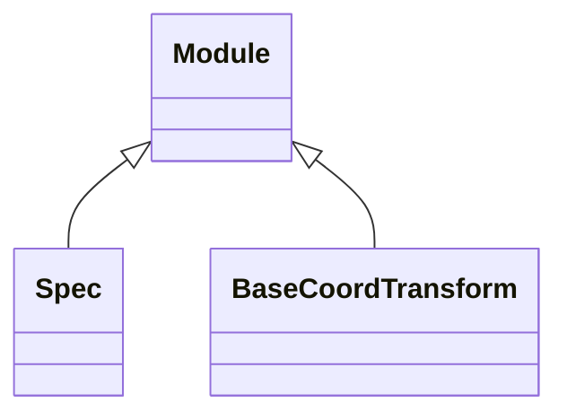

<!-- Generated by docs/scripts/generate_api_mds.py; do not edit. -->

# Coordinates

## Inheritance

???+ info "Spec"
    ::: dLux.utils.grids.specs.Spec
        options:
          merge_init_into_class: true
          inherited_members: [__init__]

???+ info "PadSpec"
    ::: dLux.compat.coordinates.PadSpec

???+ info "CoordSpec"
    ::: dLux.compat.coordinates.CoordSpec

???+ info "BaseCoordTransform"
    ::: dLux.utils.grids.transforms.BaseCoordTransform
        options:
          merge_init_into_class: true
          inherited_members: [__init__]

???+ info "CoordTransform"
    ::: dLux.compat.coordinates.CoordTransform

???+ info "DistortedCoords"
    ::: dLux.compat.coordinates.DistortedCoords
