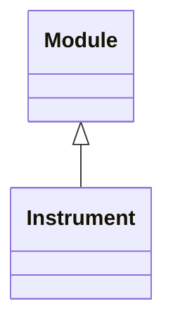

<!-- Generated by docs/scripts/generate_api_mds.py; do not edit. -->

# Instruments

## Inheritance

???+ info "Instrument"
    ::: dLux.systems.imagers.Imager
        options:
          merge_init_into_class: true
          inherited_members: [__init__]

???+ info "Telescope"
    ::: dLux.compat.instruments.Telescope

???+ info "Dither"
    ::: dLux.compat.instruments.Dither
