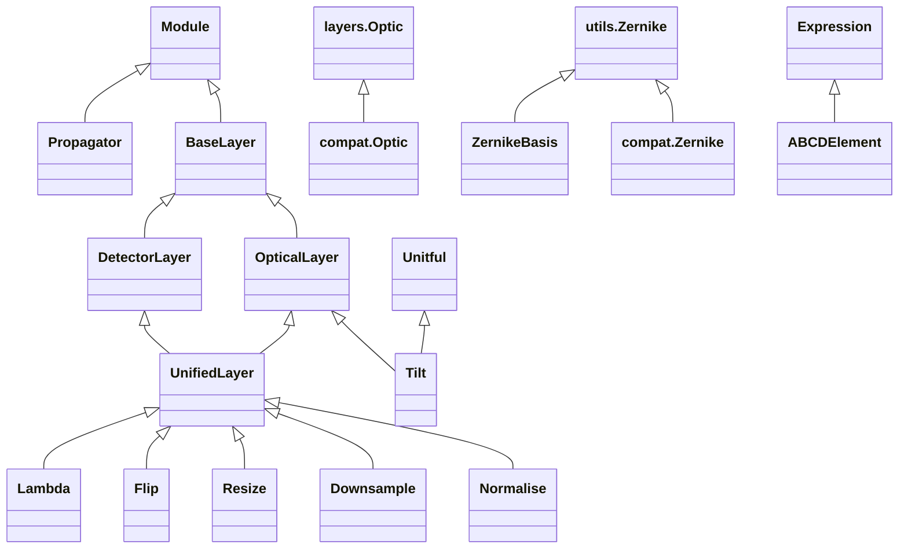

<!-- Generated by docs/scripts/generate_api_mds.py; do not edit. -->

# Layers

## Inheritance

???+ info "BaseLayer"
    ::: dLux.utils.sequential.BaseLayer
        options:
          merge_init_into_class: true
          inherited_members: [__init__]

???+ info "OpticalLayer"
    ::: dLux.layers.optical.OpticalLayer
        options:
          merge_init_into_class: true
          inherited_members: [__init__]

???+ info "TransmissiveLayer"
    ::: dLux.compat.layers.optical_layers.TransmissiveLayer

???+ info "AberratedLayer"
    ::: dLux.compat.layers.optical_layers.AberratedLayer

???+ info "BasisLayer"
    ::: dLux.compat.layers.optical_layers.BasisLayer

???+ info "Tilt"
    ::: dLux.layers.optical.TiltLayer
        options:
          merge_init_into_class: true
          inherited_members: [__init__]

???+ info "Normalise"
    ::: dLux.layers.unified.NormaliseLayer
        options:
          merge_init_into_class: true
          inherited_members: [__init__]

???+ info "FourierBasis"
    ::: dLux.compat.layers.optical_layers.FourierBasis

???+ info "Optic"
    ::: dLux.compat.layers.optics.Optic
        options:
          merge_init_into_class: true
          inherited_members: [__init__]

???+ info "BasisOptic"
    ::: dLux.compat.layers.optics.BasisOptic

???+ info "DetectorLayer"
    ::: dLux.layers.detector.DetectorLayer
        options:
          merge_init_into_class: true
          inherited_members: [__init__]

???+ info "ApplyPixelResponse"
    ::: dLux.compat.layers.detector_layers.ApplyPixelResponse

???+ info "ApplyJitter"
    ::: dLux.compat.layers.detector_layers.ApplyJitter

???+ info "ApplySaturation"
    ::: dLux.compat.layers.detector_layers.ApplySaturation

???+ info "AddConstant"
    ::: dLux.compat.layers.detector_layers.AddConstant

???+ info "Downsample"
    ::: dLux.layers.unified.DownsampleLayer
        options:
          merge_init_into_class: true
          inherited_members: [__init__]

???+ info "UnifiedLayer"
    ::: dLux.layers.unified.UnifiedLayer
        options:
          merge_init_into_class: true
          inherited_members: [__init__]

???+ info "Resize"
    ::: dLux.layers.unified.ResizeLayer
        options:
          merge_init_into_class: true
          inherited_members: [__init__]

???+ info "Rotate"
    ::: dLux.compat.layers.unified_layers.Rotate

???+ info "Flip"
    ::: dLux.layers.unified.FlipLayer
        options:
          merge_init_into_class: true
          inherited_members: [__init__]

???+ info "Lambda"
    ::: dLux.layers.unified.LambdaLayer
        options:
          merge_init_into_class: true
          inherited_members: [__init__]

???+ info "Propagator"
    ::: dLux.utils.propagation.propagators.BasePropagator
        options:
          merge_init_into_class: true
          inherited_members: [__init__]

???+ info "FFT"
    ::: dLux.compat.layers.propagators.FFT

???+ info "MFT"
    ::: dLux.compat.layers.propagators.MFT

???+ info "ApertureLayer"
    Alias of [`OpticalLayer`](#dLux.layers.optical.OpticalLayer).

???+ info "BaseDynamicAperture"
    Alias of [`OpticalLayer`](#dLux.layers.optical.OpticalLayer).

???+ info "DynamicAperture"
    Alias of [`OpticalLayer`](#dLux.layers.optical.OpticalLayer).

???+ info "CircularAperture"
    ::: dLux.compat.layers.apertures.CircularAperture

???+ info "SquareAperture"
    ::: dLux.compat.layers.apertures.SquareAperture

???+ info "RectangularAperture"
    ::: dLux.compat.layers.apertures.RectangularAperture

???+ info "RegPolyAperture"
    ::: dLux.compat.layers.apertures.RegPolyAperture

???+ info "Spider"
    ::: dLux.compat.layers.apertures.Spider

???+ info "AberratedAperture"
    ::: dLux.compat.layers.apertures.AberratedAperture

???+ info "CompositeAperture"
    ::: dLux.compat.layers.apertures.CompositeAperture

???+ info "CompoundAperture"
    ::: dLux.compat.layers.apertures.CompoundAperture

???+ info "MultiAperture"
    ::: dLux.compat.layers.apertures.MultiAperture

???+ info "Zernike"
    ::: dLux.compat.layers.aberrations.Zernike
        options:
          merge_init_into_class: true
          inherited_members: [__init__]

???+ info "ZernikeBasis"
    ::: dLux.compat.layers.aberrations.ZernikeBasis
        options:
          merge_init_into_class: true
          inherited_members: [__init__]

???+ info "ABCDElement"
    ::: dLux.utils.propagation.abcd.ABCD
        options:
          merge_init_into_class: true
          inherited_members: [__init__]

???+ info "ABCDFreeSpace"
    ::: dLux.compat.layers.abcd_propagators.ABCDFreeSpace

???+ info "ABCDLens"
    ::: dLux.compat.layers.abcd_propagators.ABCDLens

???+ info "ABCDMirror"
    ::: dLux.compat.layers.abcd_propagators.ABCDMirror

???+ info "ABCDConjugatePlane"
    ::: dLux.compat.layers.abcd_propagators.ABCDConjugatePlane

???+ info "ABCDPropagator"
    ::: dLux.compat.layers.abcd_propagators.ABCDPropagator

???+ info "MFTPropagator"
    Alias of [`ABCDPropagator`](#dLux.compat.layers.abcd_propagators.ABCDPropagator).

???+ info "FFTPropagator"
    ::: dLux.compat.layers.abcd_propagators.FFTPropagator

???+ info "ASMPropagator"
    ::: dLux.compat.layers.abcd_propagators.ASMPropagator
