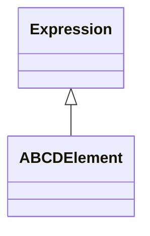

<!-- Generated by docs/scripts/generate_api_mds.py; do not edit. -->

# Layers / Abcd Propagators

## Inheritance

???+ info "ABCDElement"
    ::: dLux.utils.propagation.abcd.ABCD
        options:
          merge_init_into_class: true
          inherited_members: [__init__]

???+ info "ABCDFreeSpace"
    ::: dLux.compat.layers.abcd_propagators.ABCDFreeSpace

???+ info "ABCDLens"
    ::: dLux.compat.layers.abcd_propagators.ABCDLens

???+ info "ABCDMirror"
    ::: dLux.compat.layers.abcd_propagators.ABCDMirror

???+ info "ABCDConjugatePlane"
    ::: dLux.compat.layers.abcd_propagators.ABCDConjugatePlane

???+ info "ABCDPropagator"
    ::: dLux.compat.layers.abcd_propagators.ABCDPropagator

???+ info "MFTPropagator"
    Alias of [`ABCDPropagator`](#dLux.compat.layers.abcd_propagators.ABCDPropagator).

???+ info "FFTPropagator"
    ::: dLux.compat.layers.abcd_propagators.FFTPropagator

???+ info "ASMPropagator"
    ::: dLux.compat.layers.abcd_propagators.ASMPropagator
