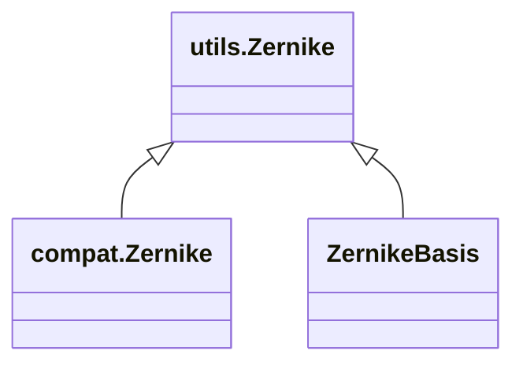

<!-- Generated by docs/scripts/generate_api_mds.py; do not edit. -->

# Layers / Aberrations

## Inheritance

???+ info "Zernike"
    ::: dLux.compat.layers.aberrations.Zernike
        options:
          merge_init_into_class: true
          inherited_members: [__init__]

???+ info "ZernikeBasis"
    ::: dLux.compat.layers.aberrations.ZernikeBasis
        options:
          merge_init_into_class: true
          inherited_members: [__init__]
