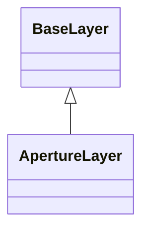

<!-- Generated by docs/scripts/generate_api_mds.py; do not edit. -->

# Layers / Apertures

## Inheritance

???+ info "ApertureLayer"
    ::: dLux.layers.optical.OpticalLayer
        options:
          merge_init_into_class: true
          inherited_members: [__init__]

???+ info "BaseDynamicAperture"
    Alias of [`ApertureLayer`](#dLux.layers.optical.OpticalLayer).

???+ info "DynamicAperture"
    Alias of [`ApertureLayer`](#dLux.layers.optical.OpticalLayer).

???+ info "CircularAperture"
    ::: dLux.compat.layers.apertures.CircularAperture

???+ info "SquareAperture"
    ::: dLux.compat.layers.apertures.SquareAperture

???+ info "RectangularAperture"
    ::: dLux.compat.layers.apertures.RectangularAperture

???+ info "RegPolyAperture"
    ::: dLux.compat.layers.apertures.RegPolyAperture

???+ info "Spider"
    ::: dLux.compat.layers.apertures.Spider

???+ info "AberratedAperture"
    ::: dLux.compat.layers.apertures.AberratedAperture

???+ info "CompositeAperture"
    ::: dLux.compat.layers.apertures.CompositeAperture

???+ info "CompoundAperture"
    ::: dLux.compat.layers.apertures.CompoundAperture

???+ info "MultiAperture"
    ::: dLux.compat.layers.apertures.MultiAperture
