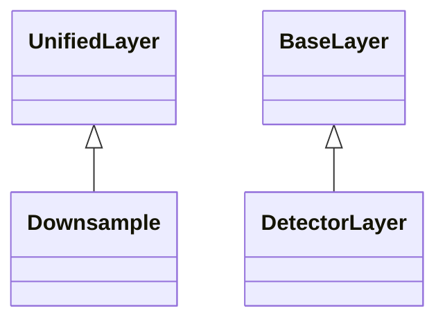

<!-- Generated by docs/scripts/generate_api_mds.py; do not edit. -->

# Layers / Detector Layers

## Inheritance

???+ info "DetectorLayer"
    ::: dLux.layers.detector.DetectorLayer
        options:
          merge_init_into_class: true
          inherited_members: [__init__]

???+ info "ApplyPixelResponse"
    ::: dLux.compat.layers.detector_layers.ApplyPixelResponse

???+ info "ApplyJitter"
    ::: dLux.compat.layers.detector_layers.ApplyJitter

???+ info "ApplySaturation"
    ::: dLux.compat.layers.detector_layers.ApplySaturation

???+ info "AddConstant"
    ::: dLux.compat.layers.detector_layers.AddConstant

???+ info "Downsample"
    ::: dLux.layers.unified.DownsampleLayer
        options:
          merge_init_into_class: true
          inherited_members: [__init__]
