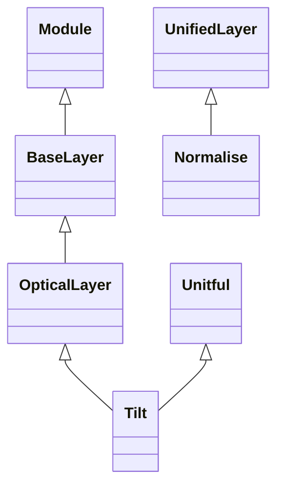

<!-- Generated by docs/scripts/generate_api_mds.py; do not edit. -->

# Layers / Optical Layers

## Inheritance

???+ info "BaseLayer"
    ::: dLux.utils.sequential.BaseLayer
        options:
          merge_init_into_class: true
          inherited_members: [__init__]

???+ info "OpticalLayer"
    ::: dLux.layers.optical.OpticalLayer
        options:
          merge_init_into_class: true
          inherited_members: [__init__]

???+ info "TransmissiveLayer"
    ::: dLux.compat.layers.optical_layers.TransmissiveLayer

???+ info "AberratedLayer"
    ::: dLux.compat.layers.optical_layers.AberratedLayer

???+ info "BasisLayer"
    ::: dLux.compat.layers.optical_layers.BasisLayer

???+ info "Tilt"
    ::: dLux.layers.optical.TiltLayer
        options:
          merge_init_into_class: true
          inherited_members: [__init__]

???+ info "Normalise"
    ::: dLux.layers.unified.NormaliseLayer
        options:
          merge_init_into_class: true
          inherited_members: [__init__]

???+ info "FourierBasis"
    ::: dLux.compat.layers.optical_layers.FourierBasis
