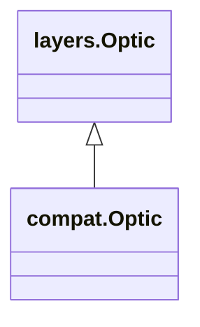

<!-- Generated by docs/scripts/generate_api_mds.py; do not edit. -->

# Layers / Optics

## Inheritance

???+ info "Optic"
    ::: dLux.compat.layers.optics.Optic
        options:
          merge_init_into_class: true
          inherited_members: [__init__]

???+ info "BasisOptic"
    ::: dLux.compat.layers.optics.BasisOptic
