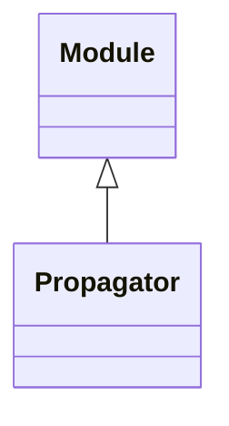

<!-- Generated by docs/scripts/generate_api_mds.py; do not edit. -->

# Layers / Propagators

## Inheritance

???+ info "Propagator"
    ::: dLux.utils.propagation.propagators.BasePropagator
        options:
          merge_init_into_class: true
          inherited_members: [__init__]

???+ info "FFT"
    ::: dLux.compat.layers.propagators.FFT

???+ info "MFT"
    ::: dLux.compat.layers.propagators.MFT
