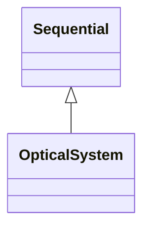

<!-- Generated by docs/scripts/generate_api_mds.py; do not edit. -->

# Optical Systems

## Inheritance

???+ info "OpticalSystem"
    ::: dLux.systems.optical.OpticalSystem
        options:
          merge_init_into_class: true
          inherited_members: [__init__]

???+ info "BaseOpticalSystem"
    Alias of [`OpticalSystem`](#dLux.systems.optical.OpticalSystem).

???+ info "LayeredOpticalSystem"
    ::: dLux.compat.optical_systems.LayeredOpticalSystem

???+ info "ParametricOpticalSystem"
    ::: dLux.compat.optical_systems.ParametricOpticalSystem

???+ info "AngularOpticalSystem"
    ::: dLux.compat.optical_systems.AngularOpticalSystem

???+ info "CartesianOpticalSystem"
    ::: dLux.compat.optical_systems.CartesianOpticalSystem
