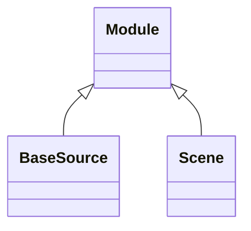

<!-- Generated by docs/scripts/generate_api_mds.py; do not edit. -->

# Sources

## Inheritance

???+ info "BaseSource"
    ::: dLux.systems.sources.Source
        options:
          merge_init_into_class: true
          inherited_members: [__init__]

???+ info "Source"
    ::: dLux.compat.sources.Source

???+ info "PointSource"
    ::: dLux.compat.sources.PointSource

???+ info "PointSources"
    ::: dLux.compat.sources.PointSources

???+ info "BinarySource"
    ::: dLux.compat.sources.BinarySource

???+ info "ResolvedSource"
    ::: dLux.compat.sources.ResolvedSource

???+ info "PointResolvedSource"
    ::: dLux.compat.sources.PointResolvedSource

???+ info "Scene"
    ::: dLux.systems.sources.Scene
        options:
          merge_init_into_class: true
          inherited_members: [__init__]
