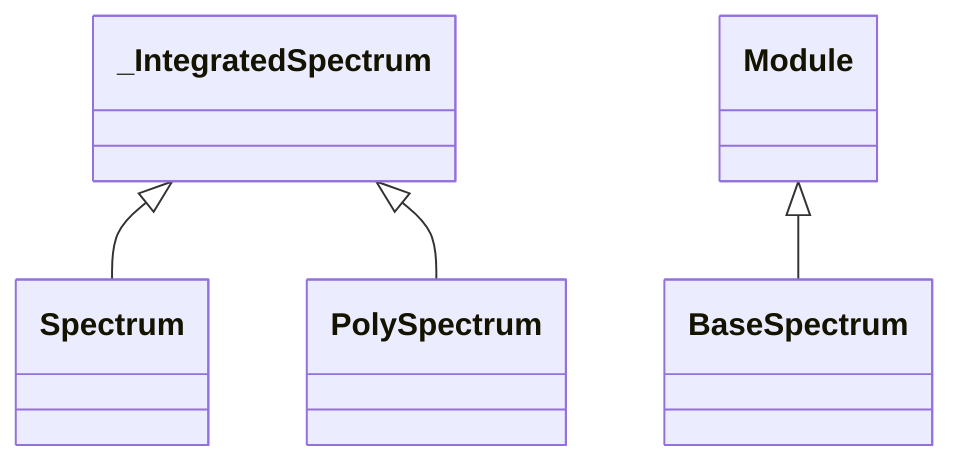

<!-- Generated by docs/scripts/generate_api_mds.py; do not edit. -->

# Spectra

## Inheritance

???+ info "BaseSpectrum"
    ::: dLux.utils.photometry.spectral.BaseSpectrum
        options:
          merge_init_into_class: true
          inherited_members: [__init__]

???+ info "SimpleSpectrum"
    ::: dLux.compat.spectra.SimpleSpectrum

???+ info "Spectrum"
    ::: dLux.compat.spectra.Spectrum
        options:
          merge_init_into_class: true
          inherited_members: [__init__]

???+ info "PolySpectrum"
    ::: dLux.compat.spectra.PolySpectrum
        options:
          merge_init_into_class: true
          inherited_members: [__init__]
