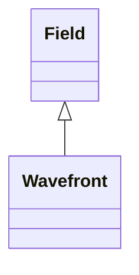

<!-- Generated by docs/scripts/generate_api_mds.py; do not edit. -->

# Wavefronts

## Inheritance

???+ info "Wavefront"
    ::: dLux.fields.wavefront.Wavefront
        options:
          merge_init_into_class: true
          inherited_members: [__init__]
