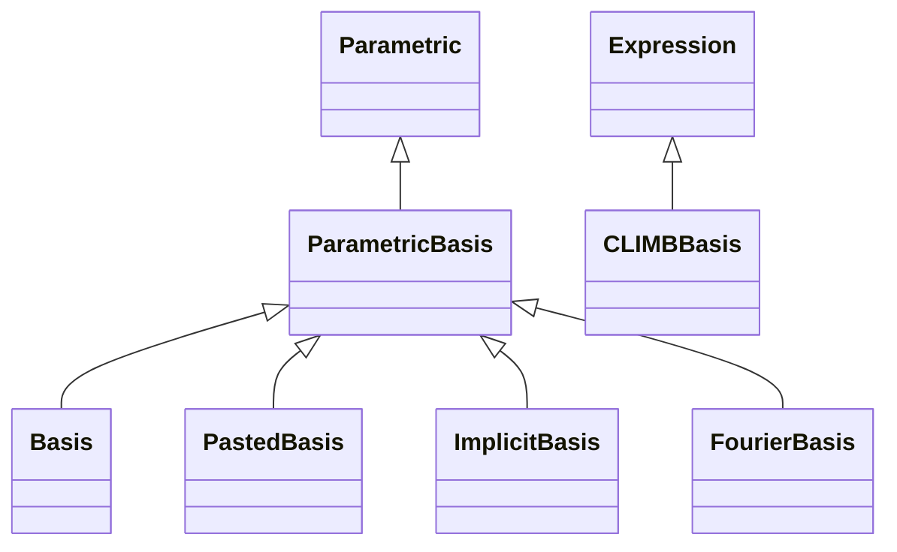

<!-- Generated by docs/scripts/generate_api_mds.py; do not edit. -->

# Bases

## Inheritance

???+ info "ParametricBasis"
    ::: dLux.parametric.bases.ParametricBasis

???+ info "Basis"
    ::: dLux.parametric.bases.Basis

???+ info "PastedBasis"
    ::: dLux.parametric.bases.PastedBasis

???+ info "ImplicitBasis"
    ::: dLux.parametric.bases.ImplicitBasis

???+ info "CLIMBBasis"
    ::: dLux.parametric.bases.CLIMBBasis

???+ info "FourierBasis"
    ::: dLux.parametric.bases.FourierBasis
