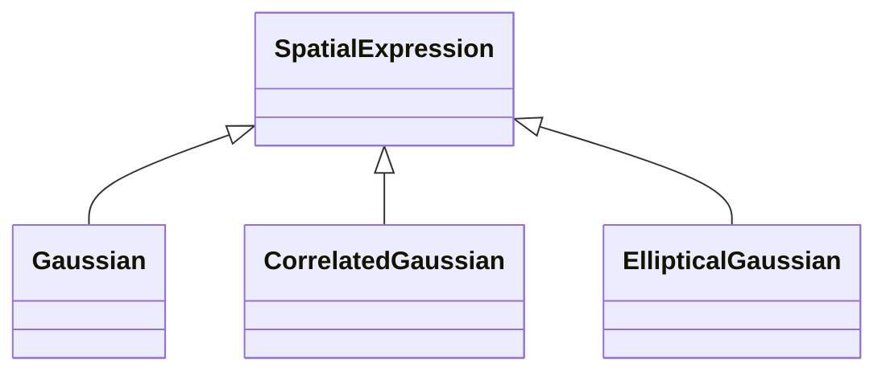

<!-- Generated by docs/scripts/generate_api_mds.py; do not edit. -->

# Gaussians

## Inheritance

???+ info "Gaussian"
    ::: dLux.parametric.gaussians.Gaussian

???+ info "CorrelatedGaussian"
    ::: dLux.parametric.gaussians.CorrelatedGaussian

???+ info "EllipticalGaussian"
    ::: dLux.parametric.gaussians.EllipticalGaussian
