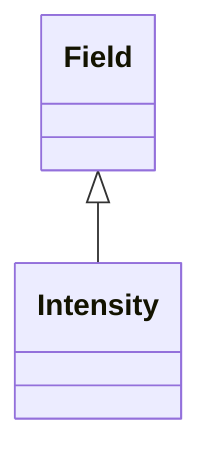

<!-- Generated by docs/scripts/generate_api_mds.py; do not edit. -->

# Intensity

## Inheritance

???+ info "Intensity"
    ::: dLux.fields.intensity.Intensity
        options:
          merge_init_into_class: true
          inherited_members: [__init__]
