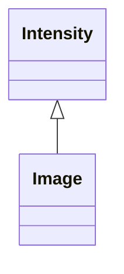
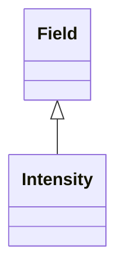
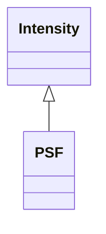
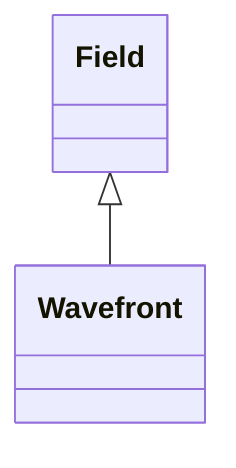

<!-- Generated by docs/scripts/generate_api_mds.py; do not edit. -->

# Fields

See the [usage overview](../../overviews/fields/overview.md) for examples.

These maps are generated from the public API. Each module is shown separately so its complete local structure remains readable. Select a class to open its reference, or follow the module heading for functions and full documentation.

## [Image](image.md)

## [Intensity](intensity.md)

## [Psf](psf.md)

## [Wavefront](wavefront.md)

