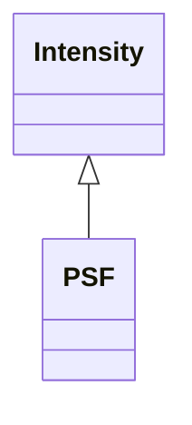

<!-- Generated by docs/scripts/generate_api_mds.py; do not edit. -->

# Psf

## Inheritance

???+ info "PSF"
    ::: dLux.fields.psf.PSF
        options:
          merge_init_into_class: true
          inherited_members: [__init__]
