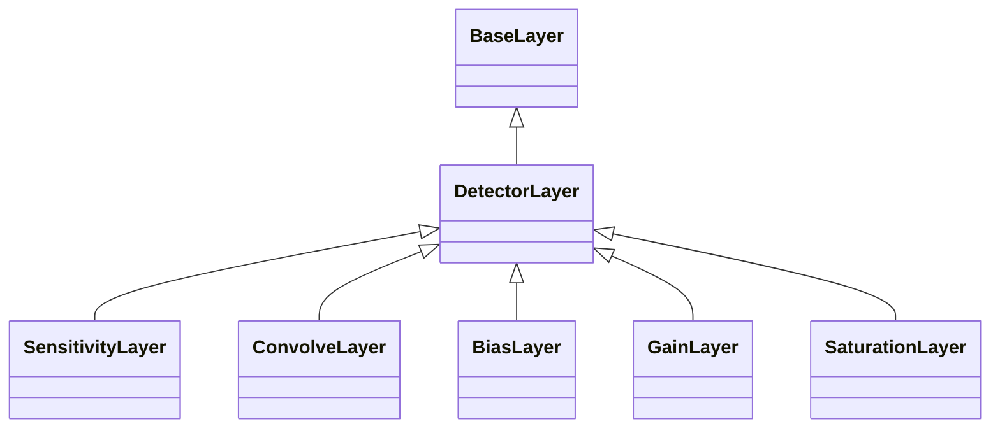

<!-- Generated by docs/scripts/generate_api_mds.py; do not edit. -->

# Detector

## Inheritance

???+ info "DetectorLayer"
    ::: dLux.layers.detector.DetectorLayer
        options:
          merge_init_into_class: true
          inherited_members: [__init__]

???+ info "SensitivityLayer"
    ::: dLux.layers.detector.SensitivityLayer
        options:
          merge_init_into_class: true
          inherited_members: [__init__]

???+ info "ConvolveLayer"
    ::: dLux.layers.detector.ConvolveLayer
        options:
          merge_init_into_class: true
          inherited_members: [__init__]

???+ info "BiasLayer"
    ::: dLux.layers.detector.BiasLayer
        options:
          merge_init_into_class: true
          inherited_members: [__init__]

???+ info "GainLayer"
    ::: dLux.layers.detector.GainLayer
        options:
          merge_init_into_class: true
          inherited_members: [__init__]

???+ info "SaturationLayer"
    ::: dLux.layers.detector.SaturationLayer
        options:
          merge_init_into_class: true
          inherited_members: [__init__]
