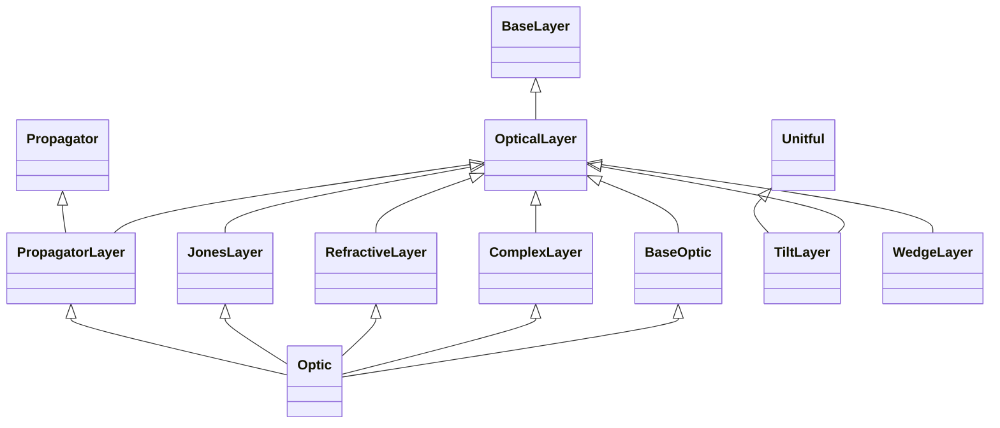

<!-- Generated by docs/scripts/generate_api_mds.py; do not edit. -->

# Optical

## Inheritance

???+ info "OpticalLayer"
    ::: dLux.layers.optical.OpticalLayer
        options:
          merge_init_into_class: true
          inherited_members: [__init__]

???+ info "ComplexLayer"
    ::: dLux.layers.optical.ComplexLayer
        options:
          merge_init_into_class: true
          inherited_members: [__init__]

???+ info "BaseOptic"
    ::: dLux.layers.optical.BaseOptic
        options:
          merge_init_into_class: true
          inherited_members: [__init__]

???+ info "RefractiveLayer"
    ::: dLux.layers.optical.RefractiveLayer
        options:
          merge_init_into_class: true
          inherited_members: [__init__]

???+ info "JonesLayer"
    ::: dLux.layers.optical.JonesLayer
        options:
          merge_init_into_class: true
          inherited_members: [__init__]

???+ info "PropagatorLayer"
    ::: dLux.layers.optical.PropagatorLayer
        options:
          merge_init_into_class: true
          inherited_members: [__init__]

???+ info "Optic"
    ::: dLux.layers.optical.Optic
        options:
          merge_init_into_class: true
          inherited_members: [__init__]

???+ info "TiltLayer"
    ::: dLux.layers.optical.TiltLayer
        options:
          merge_init_into_class: true
          inherited_members: [__init__]

???+ info "WedgeLayer"
    ::: dLux.layers.optical.WedgeLayer
        options:
          merge_init_into_class: true
          inherited_members: [__init__]
