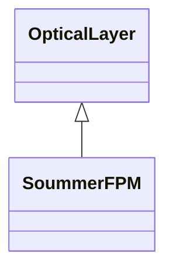
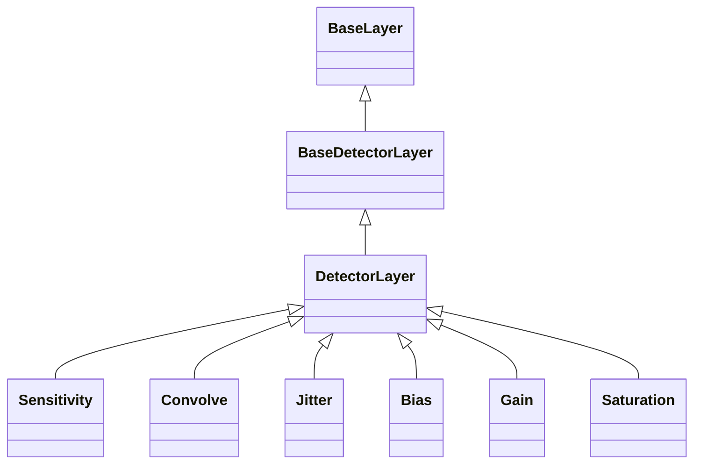
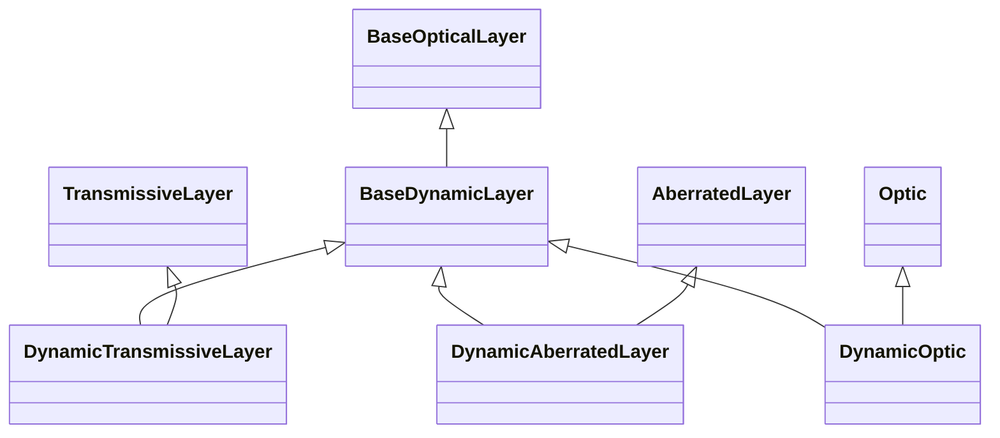
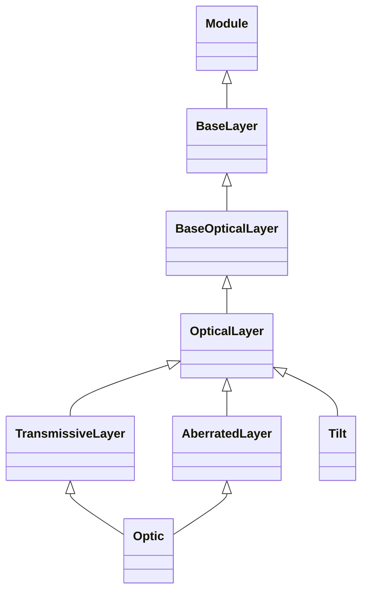
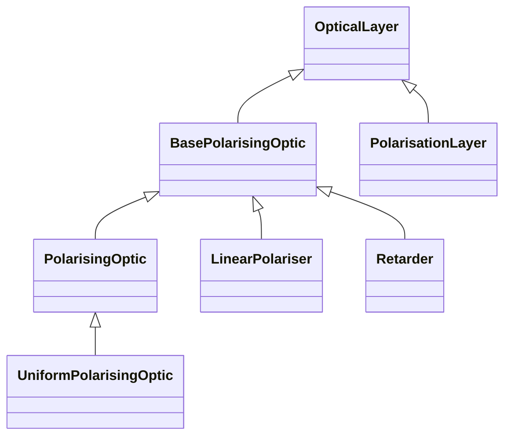
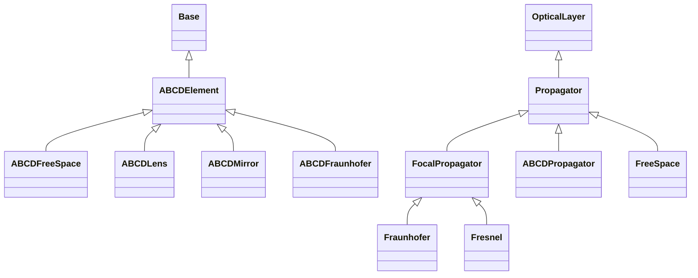
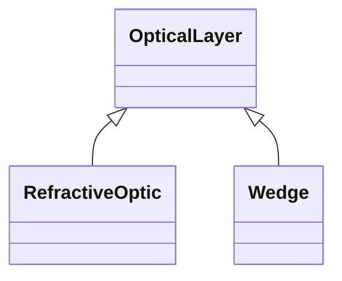
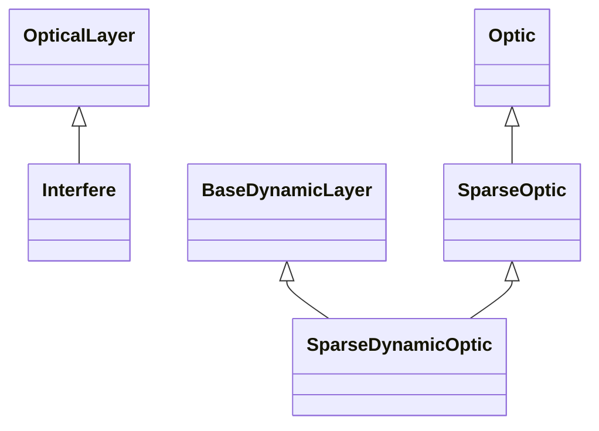
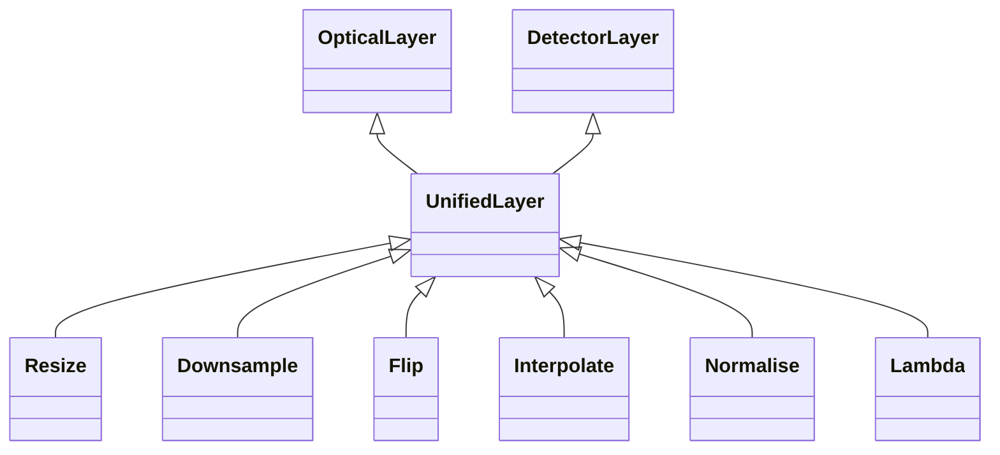

<!-- Generated by docs/scripts/generate_api_mds.py; do not edit. -->

# Layers API

## Layer contracts

Layers transform fields. Calling `layer(field, **context)` invokes `apply` and
returns a new field. Numerical attributes can hold arrays or expressions; the layer
supplies the context needed to resolve those expressions before using their values.

| Class | Input and output | Subclass contract |
| --- | --- | --- |
| `BaseLayer` | Defined by the concrete layer | Implement `apply(target, **context)`. |
| `OpticalLayer` | `Wavefront → Wavefront` | Implement `apply_mono(wavefront, **context)`; inherited application maps over wavelength and batch axes. |
| `DetectorLayer` | `Intensity → Intensity` | Implement `apply(intensity, **context)`, preserving compatible leading axes. |
| `UnifiedLayer` | `Wavefront → Wavefront` or `Intensity → Intensity` | Implement `apply_mono(target, **context)` for both field types. |

### Resolving numerical attributes

A parametric's `evaluate` method computes its value from the supplied inputs.
`resolve` returns that value when its context is available and retains the
expression when required context is missing. Layers resolve their numerical
attributes at application time, when the incident field is known. Those attributes
must resolve to values suitable for the operation being applied.

| Layer or operation | Context supplied to expressions |
| --- | --- |
| Ordinary optical layers | Incident `grid` and metre-valued `wavelengths`. |
| Dynamic and sparse optical layers | Local `coordinates`, source `pixel_scale`, and metre-valued `wavelengths`. |
| Ordinary detector layers | Incident `grid`. |
| `Gain` | Incident intensity data as the query `coordinates`. |
| `Jitter.kernel` | Local `coordinates` and `pixel_scale` in detector-pixel units; incident `data` when an intensity is supplied. |

Explicit caller context, including `state`, is forwarded. Spatial definitions
derive coordinates and pixel sampling from a supplied grid. Supplying both a grid
and coordinates to a spatial definition raises an error.

### Optical composition

`Optic` combines real amplitude transmission, amplitude scaling, OPD, phase,
material thickness and refractive index, and Jones terms. Its local operands resolve
together, allowing `Linked` and `Deferred` expressions to share values across those
attributes. Scalar modulation precedes the Jones operation and optional
normalisation. An optional outgoing propagator acts on the complete resulting field.
`phasor` returns the scalar complex multiplier.

`DynamicOptic` adds a coordinate source and transformation. Coordinate transforms
preserve the source pixel scale used for soft edges. `SparseOptic` produces one
locally sampled field per aperture; `SparseDynamicOptic` also supports transformed
sampling. These remain distinct classes with explicit geometric roles. Sparse
optics reject local Jones terms; apply a separate polarising layer before or after
them. Their scalar modulation preserves already polarised wavefronts.

Sparse optics support shared or per-aperture coefficients for `Basis`,
`ImplicitBasis` (including `DynamicZernikeBasis`), `FourierBasis`, and `Polynomial`.
One leading coefficient axis matching the number of apertures selects independent
coefficients. Other array and expression attributes are shared.

## Class maps

These maps are generated from the public API. Each module is shown separately so its complete local structure remains readable. Select a class to open its reference, or follow the module heading for functions and full documentation.

## [Coronagraphy](coronagraphy.md)

## [Detector](detector.md)

## [Dynamic](dynamic.md)

## [Optical](optical.md)

## [Polarised](polarised.md)

## [Propagation](propagation.md)

## [Refractive](refractive.md)

## [Sparse](sparse.md)

## [Unified](unified.md)

