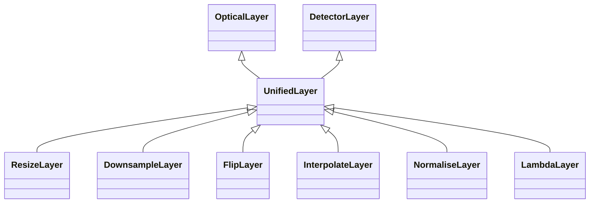

<!-- Generated by docs/scripts/generate_api_mds.py; do not edit. -->

# Unified

## Inheritance

???+ info "UnifiedLayer"
    ::: dLux.layers.unified.UnifiedLayer
        options:
          merge_init_into_class: true
          inherited_members: [__init__]

???+ info "ResizeLayer"
    ::: dLux.layers.unified.ResizeLayer
        options:
          merge_init_into_class: true
          inherited_members: [__init__]

???+ info "DownsampleLayer"
    ::: dLux.layers.unified.DownsampleLayer
        options:
          merge_init_into_class: true
          inherited_members: [__init__]

???+ info "FlipLayer"
    ::: dLux.layers.unified.FlipLayer
        options:
          merge_init_into_class: true
          inherited_members: [__init__]

???+ info "InterpolateLayer"
    ::: dLux.layers.unified.InterpolateLayer
        options:
          merge_init_into_class: true
          inherited_members: [__init__]

???+ info "NormaliseLayer"
    ::: dLux.layers.unified.NormaliseLayer
        options:
          merge_init_into_class: true
          inherited_members: [__init__]

???+ info "LambdaLayer"
    ::: dLux.layers.unified.LambdaLayer
        options:
          merge_init_into_class: true
          inherited_members: [__init__]
