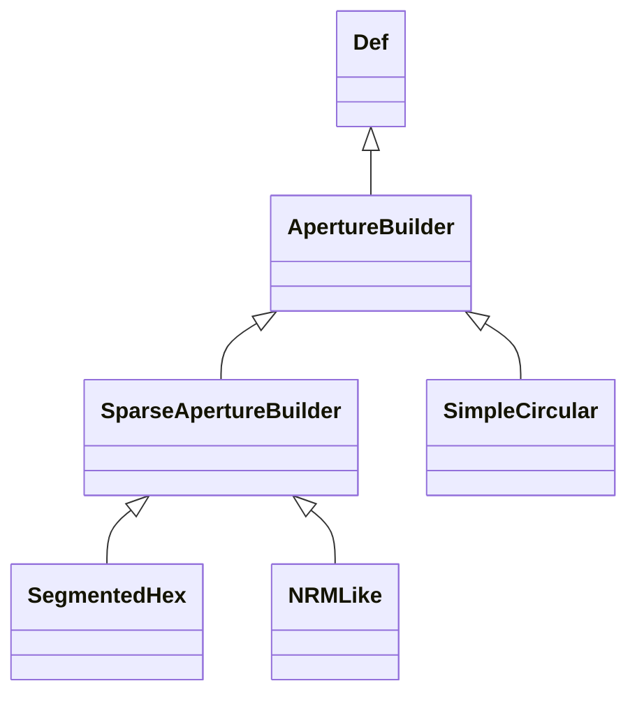

<!-- Generated by docs/scripts/generate_api_mds.py; do not edit. -->

# Apertures

## Inheritance

???+ info "ApertureBuilder"
    ::: dLux.prebuilt.apertures.ApertureBuilder
        options:
          merge_init_into_class: true
          inherited_members: [__init__]

???+ info "SparseApertureBuilder"
    ::: dLux.prebuilt.apertures.SparseApertureBuilder
        options:
          merge_init_into_class: true
          inherited_members: [__init__]

???+ info "SimpleCircular"
    ::: dLux.prebuilt.apertures.SimpleCircular
        options:
          merge_init_into_class: true
          inherited_members: [__init__]

???+ info "SegmentedHex"
    ::: dLux.prebuilt.apertures.SegmentedHex
        options:
          merge_init_into_class: true
          inherited_members: [__init__]

???+ info "NRMLike"
    ::: dLux.prebuilt.apertures.NRMLike
        options:
          merge_init_into_class: true
          inherited_members: [__init__]

???+ info "non_redundant_support"
    ::: dLux.prebuilt.apertures.non_redundant_support
