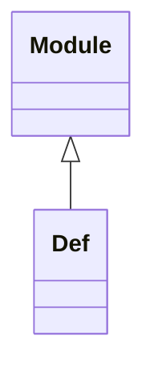

<!-- Generated by docs/scripts/generate_api_mds.py; do not edit. -->

# Definitions

## Inheritance

???+ info "Def"
    ::: dLux.prebuilt.definitions.Def
        options:
          merge_init_into_class: true
          inherited_members: [__init__]
