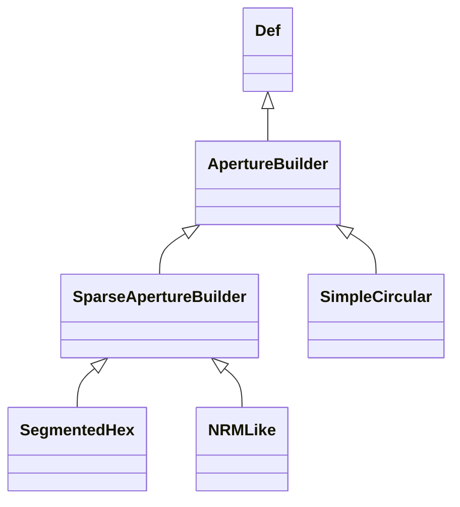
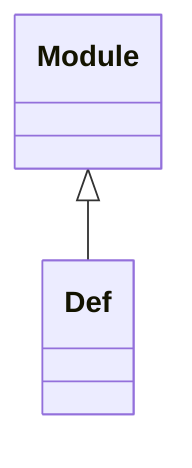
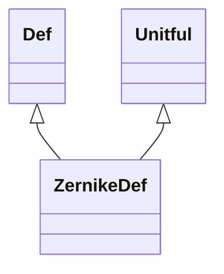

<!-- Generated by docs/scripts/generate_api_mds.py; do not edit. -->

# Prebuilt

See the [usage overview](../../overviews/prebuilt/overview.md) for examples.

These maps are generated from the public API. Each module is shown separately so its complete local structure remains readable. Select a class to open its reference, or follow the module heading for functions and full documentation.

## [Apertures](apertures.md)

Functions: [`non_redundant_support`](apertures.md#dLux.prebuilt.apertures.non_redundant_support).

## [Definitions](definitions.md)

## [Prebuilt](prebuilt.md)

Functions: [`HSTAper`](prebuilt.md#dLux.prebuilt.prebuilt.HSTAper), [`JWSTAper`](prebuilt.md#dLux.prebuilt.prebuilt.JWSTAper), [`JWSTNRMAper`](prebuilt.md#dLux.prebuilt.prebuilt.JWSTNRMAper), [`EuclidAper`](prebuilt.md#dLux.prebuilt.prebuilt.EuclidAper).
