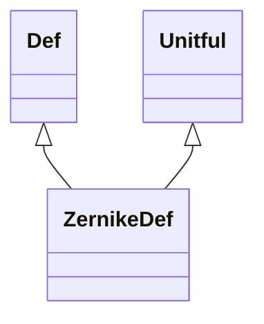

<!-- Generated by docs/scripts/generate_api_mds.py; do not edit. -->

# Prebuilt

## Inheritance

???+ info "ZernikeDef"
    ::: dLux.prebuilt.prebuilt.ZernikeDef
        options:
          merge_init_into_class: true
          inherited_members: [__init__]

???+ info "HSTAper"
    ::: dLux.prebuilt.prebuilt.HSTAper

???+ info "JWSTAper"
    ::: dLux.prebuilt.prebuilt.JWSTAper

???+ info "JWSTNRMAper"
    ::: dLux.prebuilt.prebuilt.JWSTNRMAper

???+ info "EuclidAper"
    ::: dLux.prebuilt.prebuilt.EuclidAper
