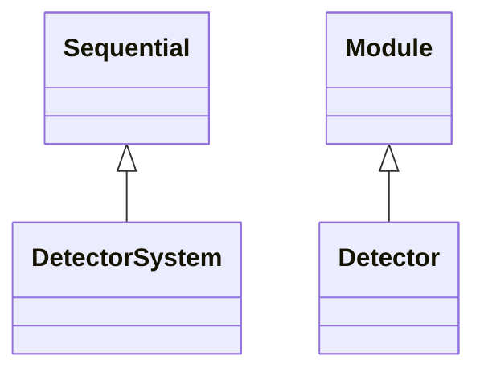

<!-- Generated by docs/scripts/generate_api_mds.py; do not edit. -->

# Detector

## Inheritance

???+ info "Detector"
    ::: dLux.systems.detector.Detector
        options:
          merge_init_into_class: true
          inherited_members: [__init__]

???+ info "DetectorSystem"
    ::: dLux.systems.detector.DetectorSystem
        options:
          merge_init_into_class: true
          inherited_members: [__init__]
