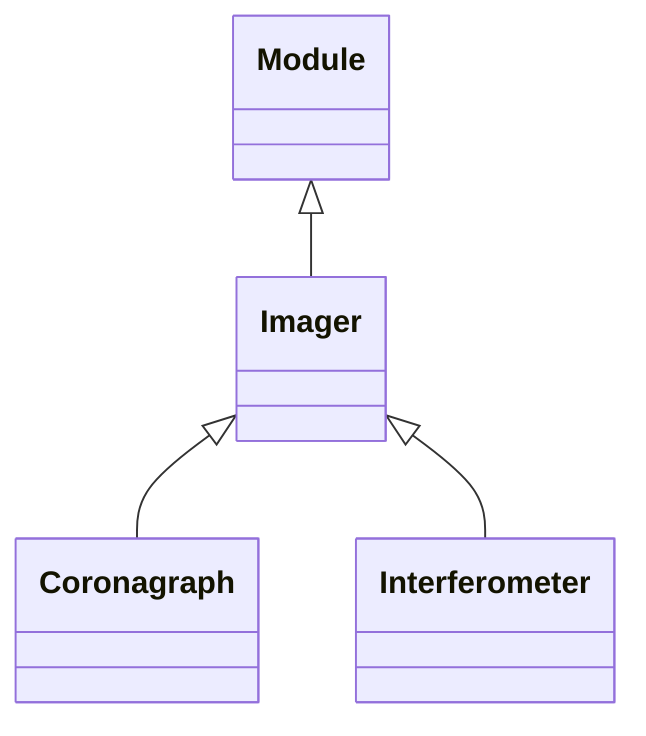

<!-- Generated by docs/scripts/generate_api_mds.py; do not edit. -->

# Imagers

## Inheritance

???+ info "Imager"
    ::: dLux.systems.imagers.Imager
        options:
          merge_init_into_class: true
          inherited_members: [__init__]

???+ info "Coronagraph"
    ::: dLux.systems.imagers.Coronagraph
        options:
          merge_init_into_class: true
          inherited_members: [__init__]

???+ info "Interferometer"
    ::: dLux.systems.imagers.Interferometer
        options:
          merge_init_into_class: true
          inherited_members: [__init__]
