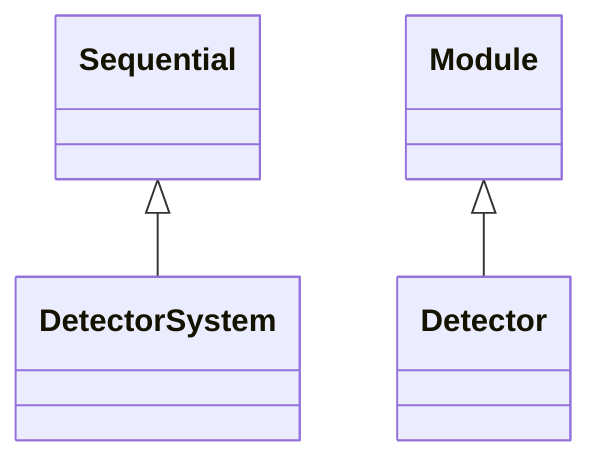
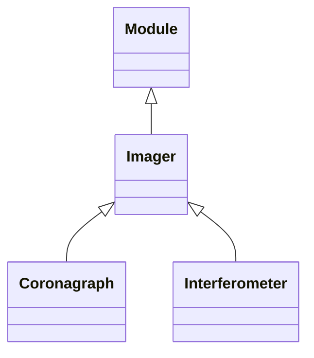
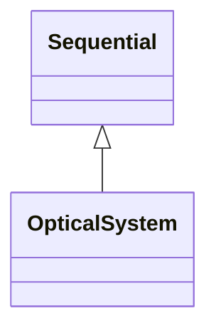
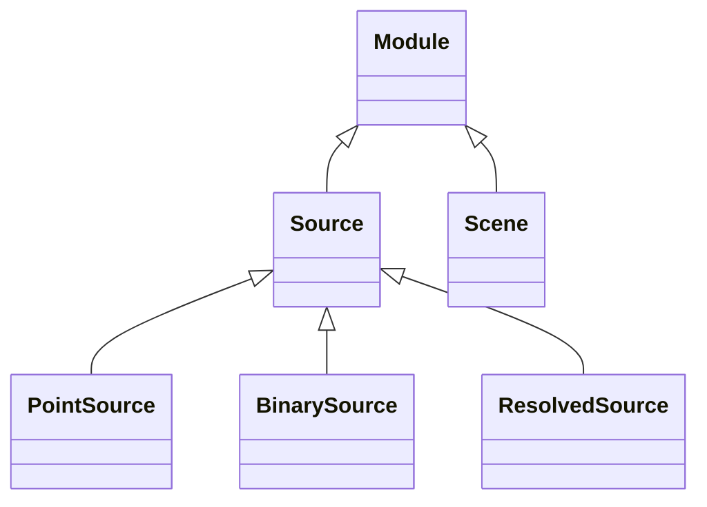

<!-- Generated by docs/scripts/generate_api_mds.py; do not edit. -->

# Systems

See the [usage overview](../../overviews/systems/overview.md) for examples.

These maps are generated from the public API. Each module is shown separately so its complete local structure remains readable. Select a class to open its reference, or follow the module heading for functions and full documentation.

## [Detector](detector.md)

## [Imagers](imagers.md)

## [Modelling](modelling.md)

Functions: [`integrate_psf`](modelling.md#dLux.systems.modelling.integrate_psf), [`render_sources`](modelling.md#dLux.systems.modelling.render_sources), [`source_profile`](modelling.md#dLux.systems.modelling.source_profile), [`source_samples`](modelling.md#dLux.systems.modelling.source_samples), [`spectral_weights`](modelling.md#dLux.systems.modelling.spectral_weights).

## [Optical](optical.md)

## [Sources](sources.md)

