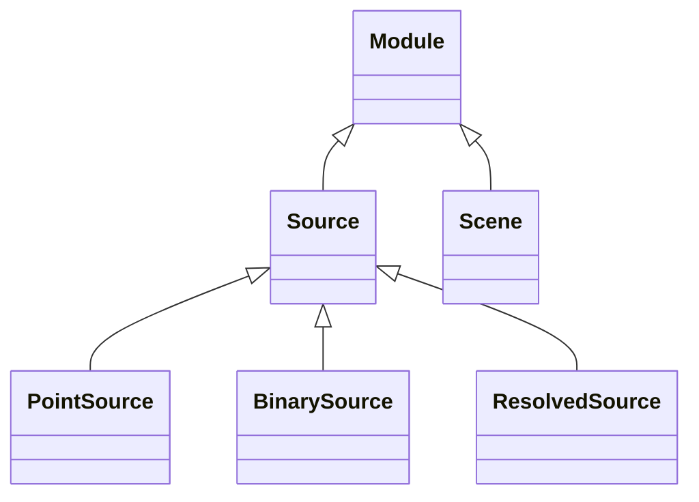

<!-- Generated by docs/scripts/generate_api_mds.py; do not edit. -->

# Sources

## Inheritance

???+ info "Source"
    ::: dLux.systems.sources.Source
        options:
          merge_init_into_class: true
          inherited_members: [__init__]

???+ info "PointSource"
    ::: dLux.systems.sources.PointSource
        options:
          merge_init_into_class: true
          inherited_members: [__init__]

???+ info "BinarySource"
    ::: dLux.systems.sources.BinarySource
        options:
          merge_init_into_class: true
          inherited_members: [__init__]

???+ info "ResolvedSource"
    ::: dLux.systems.sources.ResolvedSource
        options:
          merge_init_into_class: true
          inherited_members: [__init__]

???+ info "Scene"
    ::: dLux.systems.sources.Scene
        options:
          merge_init_into_class: true
          inherited_members: [__init__]
