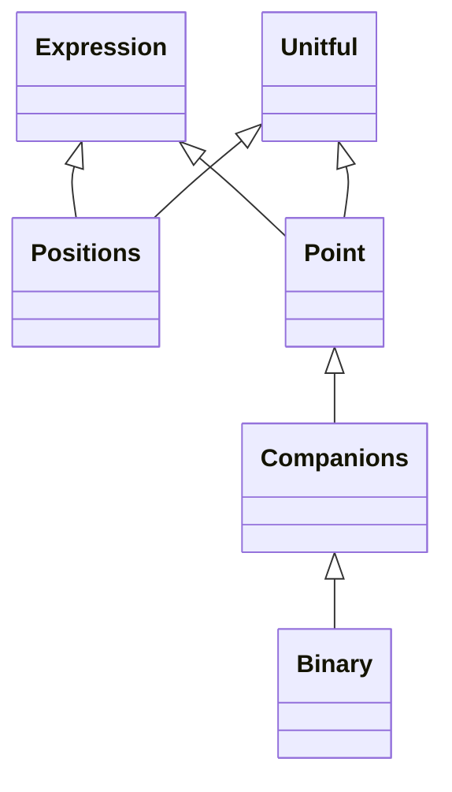

<!-- Generated by docs/scripts/generate_api_mds.py; do not edit. -->

# Astrometry

## Inheritance

???+ info "Positions"
    ::: dLux.utils.astrometry.Positions
        options:
          merge_init_into_class: true
          inherited_members: [__init__]

???+ info "Point"
    ::: dLux.utils.astrometry.Point
        options:
          merge_init_into_class: true
          inherited_members: [__init__]

???+ info "Binary"
    ::: dLux.utils.astrometry.Binary
        options:
          merge_init_into_class: true
          inherited_members: [__init__]

???+ info "Companions"
    ::: dLux.utils.astrometry.Companions
        options:
          merge_init_into_class: true
          inherited_members: [__init__]
