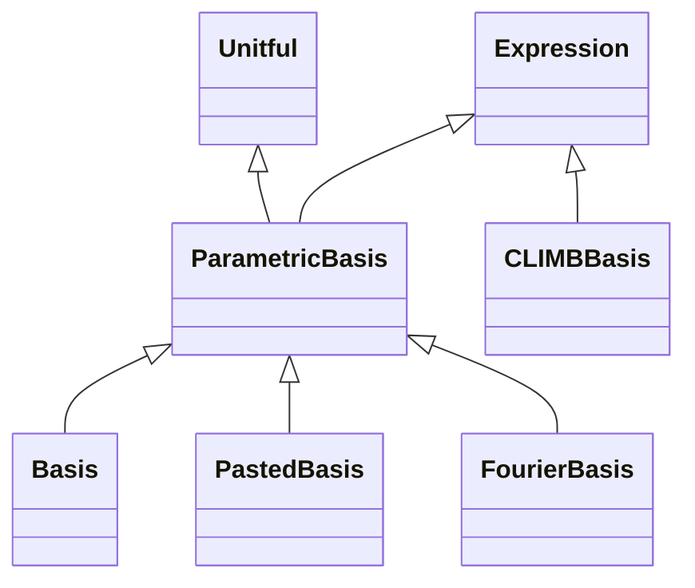

<!-- Generated by docs/scripts/generate_api_mds.py; do not edit. -->

# Bases

See the [usage overview](../../overviews/utils/bases/overview.md) for examples.

## Inheritance

???+ info "ParametricBasis"
    ::: dLux.utils.bases.basis.ParametricBasis
        options:
          merge_init_into_class: true
          inherited_members: [__init__]

???+ info "Basis"
    ::: dLux.utils.bases.basis.Basis
        options:
          merge_init_into_class: true
          inherited_members: [__init__]

???+ info "PastedBasis"
    ::: dLux.utils.bases.basis.PastedBasis
        options:
          merge_init_into_class: true
          inherited_members: [__init__]

???+ info "initialise_coeffs"
    ::: dLux.utils.bases.basis.initialise_coeffs

???+ info "eval_basis"
    ::: dLux.utils.bases.basis.eval_basis

???+ info "solve_basis"
    ::: dLux.utils.bases.basis.solve_basis

???+ info "FourierBasis"
    ::: dLux.utils.bases.fourier.FourierBasis
        options:
          merge_init_into_class: true
          inherited_members: [__init__]

???+ info "fourier_kernel_1d"
    ::: dLux.utils.bases.fourier.fourier_kernel_1d

???+ info "fourier_kernels"
    ::: dLux.utils.bases.fourier.fourier_kernels

???+ info "soft_binarise"
    ::: dLux.utils.bases.climb.soft_binarise

???+ info "CLIMBBasis"
    ::: dLux.utils.bases.climb.CLIMBBasis
        options:
          merge_init_into_class: true
          inherited_members: [__init__]
