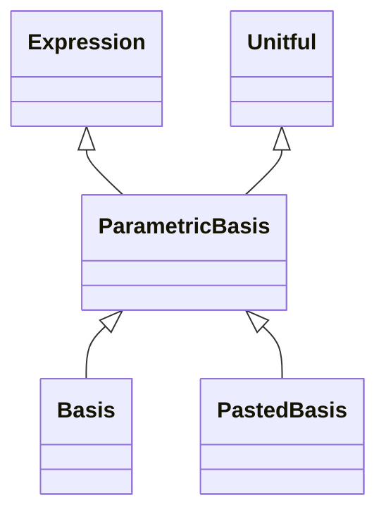

<!-- Generated by docs/scripts/generate_api_mds.py; do not edit. -->

# Bases / Basis

## Inheritance

???+ info "ParametricBasis"
    ::: dLux.utils.bases.basis.ParametricBasis
        options:
          merge_init_into_class: true
          inherited_members: [__init__]

???+ info "Basis"
    ::: dLux.utils.bases.basis.Basis
        options:
          merge_init_into_class: true
          inherited_members: [__init__]

???+ info "PastedBasis"
    ::: dLux.utils.bases.basis.PastedBasis
        options:
          merge_init_into_class: true
          inherited_members: [__init__]

???+ info "initialise_coeffs"
    ::: dLux.utils.bases.basis.initialise_coeffs

???+ info "eval_basis"
    ::: dLux.utils.bases.basis.eval_basis

???+ info "solve_basis"
    ::: dLux.utils.bases.basis.solve_basis
