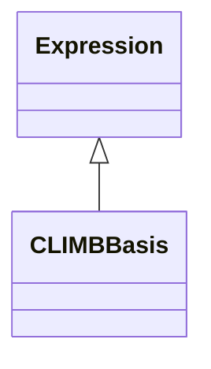

<!-- Generated by docs/scripts/generate_api_mds.py; do not edit. -->

# Bases / CLIMB

## Inheritance

???+ info "soft_binarise"
    ::: dLux.utils.bases.climb.soft_binarise

???+ info "CLIMBBasis"
    ::: dLux.utils.bases.climb.CLIMBBasis
        options:
          merge_init_into_class: true
          inherited_members: [__init__]
