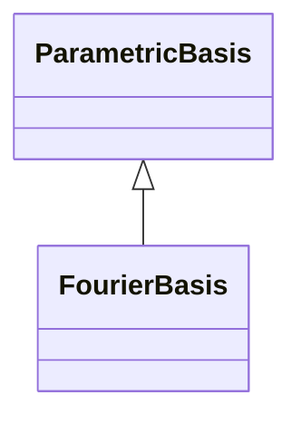

<!-- Generated by docs/scripts/generate_api_mds.py; do not edit. -->

# Bases / Fourier

## Inheritance

???+ info "FourierBasis"
    ::: dLux.utils.bases.fourier.FourierBasis
        options:
          merge_init_into_class: true
          inherited_members: [__init__]

???+ info "fourier_kernel_1d"
    ::: dLux.utils.bases.fourier.fourier_kernel_1d

???+ info "fourier_kernels"
    ::: dLux.utils.bases.fourier.fourier_kernels
