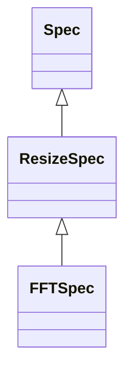

<!-- Generated by docs/scripts/generate_api_mds.py; do not edit. -->

# Compat

## Inheritance

???+ info "as_axis"
    ::: dLux.utils.batching.as_axis

???+ info "imshow_extent"
    ::: dLux.utils.compat.helpers.imshow_extent

???+ info "cart2polar"
    ::: dLux.utils.compat.coordinates.cart2polar

???+ info "polar2cart"
    ::: dLux.utils.compat.coordinates.polar2cart

???+ info "pixel_coords"
    ::: dLux.utils.compat.coordinates.pixel_coords

???+ info "nd_axes"
    ::: dLux.utils.compat.coordinates.nd_axes

???+ info "nd_coords"
    ::: dLux.utils.compat.coordinates.nd_coords

???+ info "translate_coords"
    ::: dLux.utils.compat.coordinates.translate_coords

???+ info "compress_coords"
    ::: dLux.utils.compat.coordinates.compress_coords

???+ info "shear_coords"
    ::: dLux.utils.compat.coordinates.shear_coords

???+ info "rotate_coords"
    ::: dLux.utils.compat.coordinates.rotate_coords

???+ info "distort_coords"
    ::: dLux.utils.compat.coordinates.distort_coords

???+ info "gen_powers"
    ::: dLux.utils.compat.coordinates.gen_powers

???+ info "map2array"
    ::: dLux.utils.compat.helpers.map2array

???+ info "list2dictionary"
    ::: dLux.utils.compat.helpers.list2dictionary

???+ info "insert_layer"
    ::: dLux.utils.compat.helpers.insert_layer

???+ info "remove_layer"
    ::: dLux.utils.compat.helpers.remove_layer

???+ info "from_complex"
    ::: dLux.utils.numerical.math.from_complex

???+ info "as_size"
    ::: dLux.utils.grids.array_ops.as_size

???+ info "inherit_docstrings"
    ::: dLux.utils.compat.helpers.inherit_docstrings

???+ info "missing_attribute_error"
    ::: dLux.utils.compat.helpers.missing_attribute_error

???+ info "factorial"
    ::: dLux.utils.compat.math.factorial

???+ info "gaussian"
    ::: dLux.utils.compat.math.gaussian

???+ info "mv_gaussian"
    ::: dLux.utils.compat.math.mv_gaussian

???+ info "eval_basis"
    ::: dLux.utils.bases.basis.eval_basis

???+ info "solve_basis"
    ::: dLux.utils.compat.math.solve_basis

???+ info "triangular_number"
    ::: dLux.utils.numerical.math.triangular_number

???+ info "nandiv"
    ::: dLux.utils.numerical.math.nandiv

???+ info "canonical_unit"
    ::: dLux.utils.numerical.units.canonical_unit

???+ info "unit_factor"
    ::: dLux.utils.numerical.units.unit_factor

???+ info "unit_factor_to_rad"
    ::: dLux.utils.compat.units.unit_factor_to_rad

???+ info "convert"
    ::: dLux.utils.numerical.units.convert

???+ info "rad2arcsec"
    ::: dLux.utils.compat.units.rad2arcsec

???+ info "rad2deg"
    ::: dLux.utils.compat.units.rad2deg

???+ info "rad2arcmin"
    ::: dLux.utils.compat.units.rad2arcmin

???+ info "deg2rad"
    ::: dLux.utils.compat.units.deg2rad

???+ info "deg2arcmin"
    ::: dLux.utils.compat.units.deg2arcmin

???+ info "deg2arcsec"
    ::: dLux.utils.compat.units.deg2arcsec

???+ info "arcmin2rad"
    ::: dLux.utils.compat.units.arcmin2rad

???+ info "arcmin2deg"
    ::: dLux.utils.compat.units.arcmin2deg

???+ info "arcmin2arcsec"
    ::: dLux.utils.compat.units.arcmin2arcsec

???+ info "arcsec2rad"
    ::: dLux.utils.compat.units.arcsec2rad

???+ info "arcsec2deg"
    ::: dLux.utils.compat.units.arcsec2deg

???+ info "arcsec2arcmin"
    ::: dLux.utils.compat.units.arcsec2arcmin

???+ info "l1_norm"
    ::: dLux.utils.compat.norms.l1_norm

???+ info "l2_norm"
    ::: dLux.utils.compat.norms.l2_norm

???+ info "max_norm"
    ::: dLux.utils.compat.norms.max_norm

???+ info "rms_norm"
    ::: dLux.utils.compat.norms.rms_norm

???+ info "p2v_norm"
    ::: dLux.utils.compat.norms.p2v_norm

???+ info "normalise"
    ::: dLux.utils.numerical.norms.normalise

???+ info "interpolate"
    ::: dLux.utils.compat.interpolation.interpolate

???+ info "interp"
    ::: dLux.utils.numerical.interpolation.interp

???+ info "scale"
    ::: dLux.utils.compat.interpolation.scale

???+ info "rotate"
    ::: dLux.utils.compat.interpolation.rotate

???+ info "fourier_shift"
    ::: dLux.utils.propagation.fft.fourier_shift

???+ info "FFT"
    ::: dLux.utils.compat.propagation.FFT

???+ info "MFT"
    ::: dLux.utils.compat.propagation.MFT

???+ info "transfer_matrix"
    ::: dLux.utils.compat.propagation.transfer_matrix

???+ info "calc_nfringes"
    ::: dLux.utils.compat.propagation.calc_nfringes

???+ info "combine"
    ::: dLux.utils.compat.geometry.combine

???+ info "circle"
    ::: dLux.utils.compat.geometry.circle

???+ info "square"
    ::: dLux.utils.compat.geometry.square

???+ info "rectangle"
    ::: dLux.utils.compat.geometry.rectangle

???+ info "reg_polygon"
    ::: dLux.utils.compat.geometry.reg_polygon

???+ info "convex_polygon"
    ::: dLux.utils.compat.geometry.convex_polygon

???+ info "spider"
    ::: dLux.utils.compat.geometry.spider

???+ info "soft_circle"
    ::: dLux.utils.compat.geometry.soft_circle

???+ info "soft_square"
    ::: dLux.utils.compat.geometry.soft_square

???+ info "soft_rectangle"
    ::: dLux.utils.compat.geometry.soft_rectangle

???+ info "soft_reg_polygon"
    ::: dLux.utils.compat.geometry.soft_reg_polygon

???+ info "soft_convex_polygon"
    ::: dLux.utils.compat.geometry.soft_convex_polygon

???+ info "soft_spider"
    ::: dLux.utils.compat.geometry.soft_spider

???+ info "validate_convex"
    ::: dLux.utils.numerical.shapes.validate_convex

???+ info "eval_fourier_basis"
    ::: dLux.utils.compat.fourier.eval_fourier_basis

???+ info "fourier_kernel_1d"
    ::: dLux.utils.bases.fourier.fourier_kernel_1d

???+ info "fourier_kernels"
    ::: dLux.utils.bases.fourier.fourier_kernels

???+ info "fft_spec"
    ::: dLux.utils.compat.fourier.fft_spec

???+ info "fft_phase_ramp"
    ::: dLux.utils.compat.fourier.fft_phase_ramp

???+ info "non_redundant_support"
    ::: dLux.utils.compat.apertures.non_redundant_support

???+ info "circular_aperture"
    ::: dLux.utils.compat.apertures.circular_aperture

???+ info "segmented_aperture"
    ::: dLux.utils.compat.apertures.segmented_aperture

???+ info "sparse_aperture"
    ::: dLux.utils.compat.apertures.sparse_aperture

???+ info "hst_like"
    ::: dLux.utils.compat.apertures.hst_like

???+ info "jwst_like"
    ::: dLux.utils.compat.apertures.jwst_like

???+ info "euclid_like"
    ::: dLux.utils.compat.apertures.euclid_like

???+ info "zernike_name"
    ::: dLux.utils.compat.zernikes.zernike_name

???+ info "noll_indices"
    ::: dLux.utils.compat.zernikes.noll_indices

???+ info "zernike_factors"
    ::: dLux.utils.compat.zernikes.zernike_factors

???+ info "zernike"
    ::: dLux.utils.compat.zernikes.zernike

???+ info "zernike_fast"
    ::: dLux.utils.compat.zernikes.zernike_fast

???+ info "zernike_basis"
    ::: dLux.utils.compat.zernikes.zernike_basis

???+ info "polike"
    ::: dLux.utils.compat.zernikes.polike

???+ info "polike_fast"
    ::: dLux.utils.compat.zernikes.polike_fast

???+ info "polike_basis"
    ::: dLux.utils.compat.zernikes.polike_basis

???+ info "fluxes_from_contrast"
    ::: dLux.utils.compat.source.fluxes_from_contrast

???+ info "positions_from_sep"
    ::: dLux.utils.compat.source.positions_from_sep

???+ info "pad_to"
    ::: dLux.utils.grids.array_ops.pad_to

???+ info "crop_to"
    ::: dLux.utils.grids.array_ops.crop_to

???+ info "resize"
    ::: dLux.utils.grids.array_ops.resize

???+ info "downsample"
    ::: dLux.utils.grids.array_ops.downsample

???+ info "ResizeSpec"
    ::: dLux.utils.grids.array_ops.ResizeSpec
        options:
          merge_init_into_class: true
          inherited_members: [__init__]

???+ info "FFTSpec"
    ::: dLux.utils.grids.array_ops.FFTSpec
        options:
          merge_init_into_class: true
          inherited_members: [__init__]

???+ info "wavenumber"
    ::: dLux.utils.optical.phase.wavenumber

???+ info "opd2phase"
    ::: dLux.utils.optical.phase.opd2phase

???+ info "phase2opd"
    ::: dLux.utils.optical.phase.phase2opd

???+ info "fringe_size"
    ::: dLux.utils.optical.phase.fringe_size

???+ info "tilt_opd"
    ::: dLux.utils.optical.phase.tilt_opd

???+ info "tilt"
    ::: dLux.utils.optical.phase.tilt

???+ info "soft_binarise"
    ::: dLux.utils.bases.climb.soft_binarise
