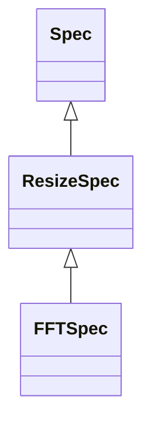

<!-- Generated by docs/scripts/generate_api_mds.py; do not edit. -->

# Compat / Array Ops

## Inheritance

???+ info "as_size"
    ::: dLux.utils.grids.array_ops.as_size

???+ info "pad_to"
    ::: dLux.utils.grids.array_ops.pad_to

???+ info "crop_to"
    ::: dLux.utils.grids.array_ops.crop_to

???+ info "resize"
    ::: dLux.utils.grids.array_ops.resize

???+ info "downsample"
    ::: dLux.utils.grids.array_ops.downsample

???+ info "ResizeSpec"
    ::: dLux.utils.grids.array_ops.ResizeSpec
        options:
          merge_init_into_class: true
          inherited_members: [__init__]

???+ info "FFTSpec"
    ::: dLux.utils.grids.array_ops.FFTSpec
        options:
          merge_init_into_class: true
          inherited_members: [__init__]
