<!-- Generated by docs/scripts/generate_api_mds.py; do not edit. -->

# Grids

See the [usage overview](../../overviews/utils/grids/overview.md) for examples.

## Inheritance

```mermaid
classDiagram
    direction TB
    class dLux_utils_grids_specs_Spec["Spec"]
    class dLux_utils_grids_specs_UnitSpec["UnitSpec"]
    class dLux_utils_grids_specs_Axis["Axis"]
    class dLux_utils_grids_array_ops_ResizeSpec["ResizeSpec"]
    class dLux_utils_grids_array_ops_FFTSpec["FFTSpec"]
    class dLux_utils_grids_transforms_BaseCoordTransform["BaseCoordTransform"]
    class dLux_utils_grids_transforms_Affine["Affine"]
    class dLux_utils_grids_transforms_AffineMap["AffineMap"]
    class dLux_utils_grids_transforms_TransformChain["TransformChain"]
    class dLux_utils_grids_transforms_Distortion["Distortion"]
    class dLux_utils_grids_transforms_Transform["Transform"]
    class dLux_utils_grids_grid_Grid["Grid"]
    class dLux_utils_grids_paste_PasteSpec["PasteSpec"]
    class dLux_utils_grids_fields_Field["Field"]
    class dLux_utils_numerical_units_Unitful["Unitful"]
    class dLux_utils_sequential_Series["Series"]
    class zodiax_module_Module["Module"]
    zodiax_module_Module <|-- dLux_utils_grids_specs_Spec
    click dLux_utils_grids_specs_Spec href "#dLux.utils.grids.specs.Spec" "Attributes: n, ndim · Properties: shape · Methods: __init__()"
    dLux_utils_grids_specs_Spec <|-- dLux_utils_grids_specs_UnitSpec
    dLux_utils_numerical_units_Unitful <|-- dLux_utils_grids_specs_UnitSpec
    click dLux_utils_grids_specs_UnitSpec href "#dLux.utils.grids.specs.UnitSpec" "Attributes: unit, d, c · Properties: ndim, batch_shape, d_si, c_si, axes, coordinates, cell_volume, fov · Methods: __init__(), match_shape(), resample(), resize(), resize_samples(), downsample(), oversample()"
    dLux_utils_grids_specs_UnitSpec <|-- dLux_utils_grids_specs_Axis
    click dLux_utils_grids_specs_Axis href "#dLux.utils.grids.specs.Axis" "Attributes: unit, n, d, c · Properties: ndim, values, integration_weights · Methods: __init__()"
    dLux_utils_grids_specs_Spec <|-- dLux_utils_grids_array_ops_ResizeSpec
    click dLux_utils_grids_array_ops_ResizeSpec href "#dLux.utils.grids.array_ops.ResizeSpec" "Attributes: n, pad, crop · Properties: ndim, explicit · Methods: __init__(), counts(), output_size(), crop_size(), pad_array(), crop_array(), crop_axes(), resize()"
    dLux_utils_grids_array_ops_ResizeSpec <|-- dLux_utils_grids_array_ops_FFTSpec
    click dLux_utils_grids_array_ops_FFTSpec href "#dLux.utils.grids.array_ops.FFTSpec" "Attributes: n, pad, crop, c · Methods: __init__(), working_grid(), output_grid()"
    zodiax_module_Module <|-- dLux_utils_grids_transforms_BaseCoordTransform
    click dLux_utils_grids_transforms_BaseCoordTransform href "#dLux.utils.grids.transforms.BaseCoordTransform" "Methods: get_coordinates(), __call__(), apply(), __init__()"
    dLux_utils_grids_transforms_BaseCoordTransform <|-- dLux_utils_grids_transforms_Affine
    click dLux_utils_grids_transforms_Affine href "#dLux.utils.grids.transforms.Affine" "Attributes: translation, rotation, scale, shear, order · Properties: coeffs · Methods: __init__(), __call__()"
    dLux_utils_grids_transforms_BaseCoordTransform <|-- dLux_utils_grids_transforms_AffineMap
    click dLux_utils_grids_transforms_AffineMap href "#dLux.utils.grids.transforms.AffineMap" "Attributes: matrix, offset · Methods: __init__(), __call__()"
    dLux_utils_sequential_Series <|-- dLux_utils_grids_transforms_TransformChain
    dLux_utils_grids_transforms_BaseCoordTransform <|-- dLux_utils_grids_transforms_TransformChain
    click dLux_utils_grids_transforms_TransformChain href "#dLux.utils.grids.transforms.TransformChain" "Attributes: layers, grid · Methods: __init__(), evaluate(), apply()"
    dLux_utils_grids_transforms_BaseCoordTransform <|-- dLux_utils_grids_transforms_Distortion
    click dLux_utils_grids_transforms_Distortion href "#dLux.utils.grids.transforms.Distortion" "Attributes: powers, distortion · Methods: __init__(), __call__()"
    dLux_utils_grids_transforms_BaseCoordTransform <|-- dLux_utils_grids_transforms_Transform
    click dLux_utils_grids_transforms_Transform href "#dLux.utils.grids.transforms.Transform" "Attributes: affine, polynomial · Methods: __init__(), __call__()"
    dLux_utils_grids_specs_UnitSpec <|-- dLux_utils_grids_grid_Grid
    click dLux_utils_grids_grid_Grid href "#dLux.utils.grids.grid.Grid" "Attributes: unit, n, d, c · Properties: ndim · Methods: __init__(), check_sampling(), frequency(), from_axes(), transformed(), extent()"
    dLux_utils_grids_specs_Spec <|-- dLux_utils_grids_paste_PasteSpec
    click dLux_utils_grids_paste_PasteSpec href "#dLux.utils.grids.paste.PasteSpec" "Attributes: n, stamp_shape, starts, offsets, d · Properties: ndim, coordinates · Methods: __init__(), from_grid(), paste(), extract()"
    zodiax_module_Module <|-- dLux_utils_grids_fields_Field
    click dLux_utils_grids_fields_Field href "#dLux.utils.grids.fields.Field" "Attributes: array, grid · Properties: real, imaginary, imag, amplitude, phase, intensity, complex, polar, field, batch_ndim, spatial_shape, axes, coordinates, xs, npixels, pixel_scale, center, diameter · Methods: __init__(), convolve(), resize(), downsample(), flip(), sample(), resample(), scale_to(), interpolate(), rotate()"
```

???+ info "Spec"
    ::: dLux.utils.grids.specs.Spec
        options:
          merge_init_into_class: true
          inherited_members: [__init__]

???+ info "UnitSpec"
    ::: dLux.utils.grids.specs.UnitSpec
        options:
          merge_init_into_class: true
          inherited_members: [__init__]

???+ info "Axis"
    ::: dLux.utils.grids.specs.Axis
        options:
          merge_init_into_class: true
          inherited_members: [__init__]

???+ info "ResizeSpec"
    ::: dLux.utils.grids.array_ops.ResizeSpec
        options:
          merge_init_into_class: true
          inherited_members: [__init__]

???+ info "FFTSpec"
    ::: dLux.utils.grids.array_ops.FFTSpec
        options:
          merge_init_into_class: true
          inherited_members: [__init__]

???+ info "BaseCoordTransform"
    ::: dLux.utils.grids.transforms.BaseCoordTransform
        options:
          merge_init_into_class: true
          inherited_members: [__init__]

???+ info "Affine"
    ::: dLux.utils.grids.transforms.Affine
        options:
          merge_init_into_class: true
          inherited_members: [__init__]

???+ info "AffineMap"
    ::: dLux.utils.grids.transforms.AffineMap
        options:
          merge_init_into_class: true
          inherited_members: [__init__]

???+ info "TransformChain"
    ::: dLux.utils.grids.transforms.TransformChain
        options:
          merge_init_into_class: true
          inherited_members: [__init__]

???+ info "Distortion"
    ::: dLux.utils.grids.transforms.Distortion
        options:
          merge_init_into_class: true
          inherited_members: [__init__]

???+ info "Transform"
    ::: dLux.utils.grids.transforms.Transform
        options:
          merge_init_into_class: true
          inherited_members: [__init__]

???+ info "Grid"
    ::: dLux.utils.grids.grid.Grid
        options:
          merge_init_into_class: true
          inherited_members: [__init__]

???+ info "PasteSpec"
    ::: dLux.utils.grids.paste.PasteSpec
        options:
          merge_init_into_class: true
          inherited_members: [__init__]

???+ info "Field"
    ::: dLux.utils.grids.fields.Field
        options:
          merge_init_into_class: true
          inherited_members: [__init__]
