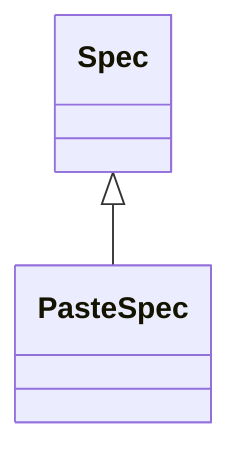

<!-- Generated by docs/scripts/generate_api_mds.py; do not edit. -->

# Grids / Paste

## Inheritance

???+ info "PasteSpec"
    ::: dLux.utils.grids.paste.PasteSpec
        options:
          merge_init_into_class: true
          inherited_members: [__init__]

???+ info "paste"
    ::: dLux.utils.grids.paste.paste
