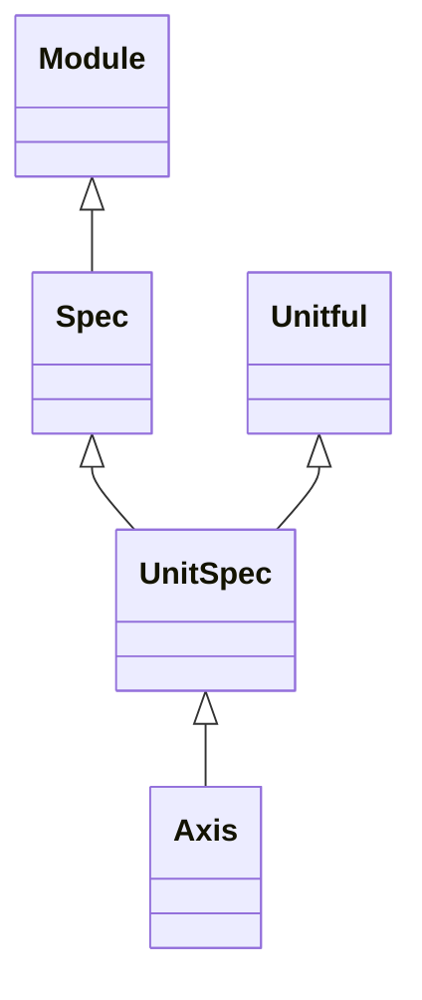

<!-- Generated by docs/scripts/generate_api_mds.py; do not edit. -->

# Grids / Specs

## Inheritance

???+ info "Spec"
    ::: dLux.utils.grids.specs.Spec
        options:
          merge_init_into_class: true
          inherited_members: [__init__]

???+ info "UnitSpec"
    ::: dLux.utils.grids.specs.UnitSpec
        options:
          merge_init_into_class: true
          inherited_members: [__init__]

???+ info "Axis"
    ::: dLux.utils.grids.specs.Axis
        options:
          merge_init_into_class: true
          inherited_members: [__init__]
