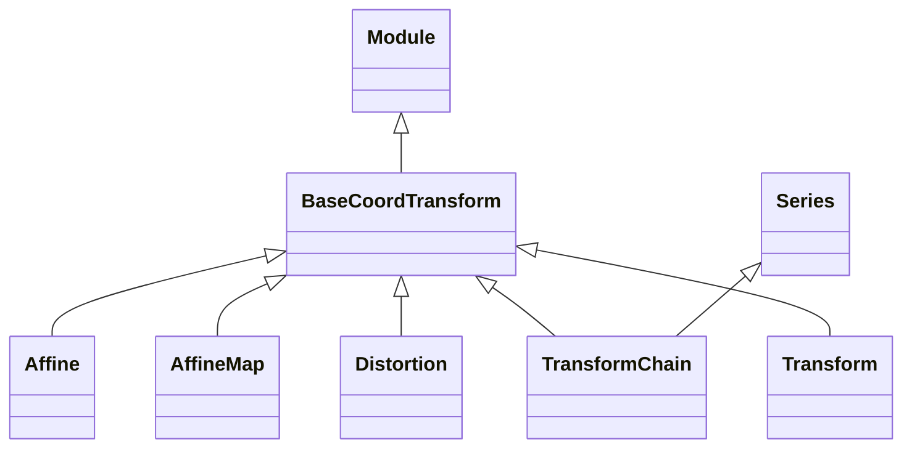

<!-- Generated by docs/scripts/generate_api_mds.py; do not edit. -->

# Grids / Transforms

## Inheritance

???+ info "BaseCoordTransform"
    ::: dLux.utils.grids.transforms.BaseCoordTransform
        options:
          merge_init_into_class: true
          inherited_members: [__init__]

???+ info "Affine"
    ::: dLux.utils.grids.transforms.Affine
        options:
          merge_init_into_class: true
          inherited_members: [__init__]

???+ info "AffineMap"
    ::: dLux.utils.grids.transforms.AffineMap
        options:
          merge_init_into_class: true
          inherited_members: [__init__]

???+ info "TransformChain"
    ::: dLux.utils.grids.transforms.TransformChain
        options:
          merge_init_into_class: true
          inherited_members: [__init__]

???+ info "Distortion"
    ::: dLux.utils.grids.transforms.Distortion
        options:
          merge_init_into_class: true
          inherited_members: [__init__]

???+ info "Transform"
    ::: dLux.utils.grids.transforms.Transform
        options:
          merge_init_into_class: true
          inherited_members: [__init__]
