<!-- Generated by docs/scripts/generate_api_mds.py; do not edit. -->

# Numerical

See the [usage overview](../../overviews/utils/numerical/overview.md) for examples.

## Inheritance

```mermaid
classDiagram
    direction TB
    class dLux_utils_numerical_units_Unitful["Unitful"]
    class dLux_utils_numerical_norms_Norm["Norm"]
    class dLux_utils_numerical_interpolation_Interp["Interp"]
    class dLux_utils_numerical_polynomials_Polynomial["Polynomial"]
    class dLux_utils_numerical_gaussians_Gaussian["Gaussian"]
    class dLux_utils_numerical_gaussians_CorrelatedGaussian["CorrelatedGaussian"]
    class dLux_utils_numerical_gaussians_EllipticalGaussian["EllipticalGaussian"]
    class dLux_utils_numerical_shapes_Shape["Shape"]
    class dLux_utils_numerical_shapes_InvertibleShape["InvertibleShape"]
    class dLux_utils_numerical_shapes_Soft["Soft"]
    class dLux_utils_numerical_shapes_Circle["Circle"]
    class dLux_utils_numerical_shapes_Square["Square"]
    class dLux_utils_numerical_shapes_Rectangle["Rectangle"]
    class dLux_utils_numerical_shapes_RegularPolygon["RegularPolygon"]
    class dLux_utils_numerical_shapes_ConvexPolygon["ConvexPolygon"]
    class dLux_utils_numerical_shapes_Spider["Spider"]
    class dLux_utils_numerical_shapes_Complement["Complement"]
    class dLux_utils_numerical_profiles_Profile["Profile"]
    class dLux_utils_numerical_profiles_Jitter["Jitter"]
    class dLux_utils_bases_basis_ParametricBasis["ParametricBasis"]
    class dLux_utils_sampled_Sampled["Sampled"]
    class zodiax_module_Module["Module"]
    class zodiax_numerics_expressions_Expression["Expression"]
    zodiax_module_Module <|-- dLux_utils_numerical_units_Unitful
    click dLux_utils_numerical_units_Unitful href "#dLux.utils.numerical.units.Unitful" "Attributes: unit · Methods: validate_unit(), __init__()"
    zodiax_numerics_expressions_Expression <|-- dLux_utils_numerical_norms_Norm
    click dLux_utils_numerical_norms_Norm href "#dLux.utils.numerical.norms.Norm" "Attributes: x, weights, mode, axis, keepdims · Methods: __init__(), evaluate()"
    zodiax_numerics_expressions_Expression <|-- dLux_utils_numerical_interpolation_Interp
    click dLux_utils_numerical_interpolation_Interp href "#dLux.utils.numerical.interpolation.Interp" "Attributes: array, grid_in, grid_out, transform, ndim, method, complex, fill, interpolator · Properties: axes · Methods: __init__(), evaluate(), __call__(), apply(), output_grid(), prepare(), sample()"
    dLux_utils_sampled_Sampled <|-- dLux_utils_numerical_polynomials_Polynomial
    dLux_utils_bases_basis_ParametricBasis <|-- dLux_utils_numerical_polynomials_Polynomial
    click dLux_utils_numerical_polynomials_Polynomial href "#dLux.utils.numerical.polynomials.Polynomial" "Attributes: unit, grid, transform, strict, coeffs, powers · Properties: coeffs_ndim · Methods: __init__(), sampling_context(), calculate_basis(), evaluate(), solve()"
    dLux_utils_sampled_Sampled <|-- dLux_utils_numerical_gaussians_Gaussian
    click dLux_utils_numerical_gaussians_Gaussian href "#dLux.utils.numerical.gaussians.Gaussian" "Attributes: grid, transform, strict, std, mean · Methods: __init__(), evaluate(), log_profile()"
    dLux_utils_sampled_Sampled <|-- dLux_utils_numerical_gaussians_CorrelatedGaussian
    click dLux_utils_numerical_gaussians_CorrelatedGaussian href "#dLux.utils.numerical.gaussians.CorrelatedGaussian" "Attributes: grid, transform, strict, stds, corr, mean · Properties: cov · Methods: __init__(), evaluate(), log_profile(), from_cov()"
    dLux_utils_sampled_Sampled <|-- dLux_utils_numerical_gaussians_EllipticalGaussian
    click dLux_utils_numerical_gaussians_EllipticalGaussian href "#dLux.utils.numerical.gaussians.EllipticalGaussian" "Attributes: grid, transform, strict, major, ratio, angle, mean · Properties: minor, cov · Methods: __init__(), evaluate(), log_profile()"
    dLux_utils_sampled_Sampled <|-- dLux_utils_numerical_shapes_Shape
    click dLux_utils_numerical_shapes_Shape href "#dLux.utils.numerical.shapes.Shape" "Attributes: grid, transform, strict · Properties: extent"
    dLux_utils_numerical_shapes_Shape <|-- dLux_utils_numerical_shapes_InvertibleShape
    click dLux_utils_numerical_shapes_InvertibleShape href "#dLux.utils.numerical.shapes.InvertibleShape" "Attributes: grid, transform, strict, edge, invert · Methods: __init__(), evaluate(), distance(), evaluate_hard(), evaluate_soft()"
    zodiax_module_Module <|-- dLux_utils_numerical_shapes_Soft
    click dLux_utils_numerical_shapes_Soft href "#dLux.utils.numerical.shapes.Soft" "Attributes: pixels · Methods: __init__(), clip()"
    dLux_utils_numerical_shapes_InvertibleShape <|-- dLux_utils_numerical_shapes_Circle
    click dLux_utils_numerical_shapes_Circle href "#dLux.utils.numerical.shapes.Circle" "Attributes: grid, transform, strict, edge, invert, diameter · Properties: extent · Methods: __init__(), distance()"
    dLux_utils_numerical_shapes_InvertibleShape <|-- dLux_utils_numerical_shapes_Square
    click dLux_utils_numerical_shapes_Square href "#dLux.utils.numerical.shapes.Square" "Attributes: grid, transform, strict, edge, invert, width · Properties: extent · Methods: __init__(), distance()"
    dLux_utils_numerical_shapes_InvertibleShape <|-- dLux_utils_numerical_shapes_Rectangle
    click dLux_utils_numerical_shapes_Rectangle href "#dLux.utils.numerical.shapes.Rectangle" "Attributes: grid, transform, strict, edge, invert, width, height · Properties: extent · Methods: __init__(), distance()"
    dLux_utils_numerical_shapes_InvertibleShape <|-- dLux_utils_numerical_shapes_RegularPolygon
    click dLux_utils_numerical_shapes_RegularPolygon href "#dLux.utils.numerical.shapes.RegularPolygon" "Attributes: grid, transform, strict, edge, invert, diameter, nsides · Properties: extent · Methods: __init__(), distance()"
    dLux_utils_numerical_shapes_InvertibleShape <|-- dLux_utils_numerical_shapes_ConvexPolygon
    click dLux_utils_numerical_shapes_ConvexPolygon href "#dLux.utils.numerical.shapes.ConvexPolygon" "Attributes: grid, transform, strict, edge, invert, vertices · Properties: extent · Methods: __init__(), distance(), evaluate_hard(), validate()"
    dLux_utils_numerical_shapes_InvertibleShape <|-- dLux_utils_numerical_shapes_Spider
    click dLux_utils_numerical_shapes_Spider href "#dLux.utils.numerical.shapes.Spider" "Attributes: grid, transform, strict, edge, invert, width, angles · Methods: __init__(), distance()"
    dLux_utils_numerical_shapes_Shape <|-- dLux_utils_numerical_shapes_Complement
    click dLux_utils_numerical_shapes_Complement href "#dLux.utils.numerical.shapes.Complement" "Attributes: grid, transform, strict, shape · Properties: extent · Methods: __init__(), evaluate()"
    zodiax_module_Module <|-- dLux_utils_numerical_profiles_Profile
    click dLux_utils_numerical_profiles_Profile href "#dLux.utils.numerical.profiles.Profile" "Attributes: profile, grid, oversample, normalise · Methods: __init__(), sample()"
    zodiax_numerics_expressions_Expression <|-- dLux_utils_numerical_profiles_Jitter
    dLux_utils_numerical_units_Unitful <|-- dLux_utils_numerical_profiles_Jitter
    click dLux_utils_numerical_profiles_Jitter href "#dLux.utils.numerical.profiles.Jitter" "Attributes: profile, unit, kernel_size, oversample · Methods: __init__(), evaluate()"
```

???+ info "triangular_number"
    ::: dLux.utils.numerical.math.triangular_number

???+ info "nandiv"
    ::: dLux.utils.numerical.math.nandiv

???+ info "from_complex"
    ::: dLux.utils.numerical.math.from_complex

???+ info "to_complex"
    ::: dLux.utils.numerical.math.to_complex

???+ info "Unitful"
    ::: dLux.utils.numerical.units.Unitful
        options:
          merge_init_into_class: true
          inherited_members: [__init__]

???+ info "canonical_unit"
    ::: dLux.utils.numerical.units.canonical_unit

???+ info "unit_dimension"
    ::: dLux.utils.numerical.units.unit_dimension

???+ info "unit_factor"
    ::: dLux.utils.numerical.units.unit_factor

???+ info "unit_factor_to_rad"
    ::: dLux.utils.numerical.units.unit_factor_to_rad

???+ info "convert"
    ::: dLux.utils.numerical.units.convert

???+ info "Norm"
    ::: dLux.utils.numerical.norms.Norm
        options:
          merge_init_into_class: true
          inherited_members: [__init__]

???+ info "norm"
    ::: dLux.utils.numerical.norms.norm

???+ info "normalise"
    ::: dLux.utils.numerical.norms.normalise

???+ info "Interp"
    ::: dLux.utils.numerical.interpolation.Interp
        options:
          merge_init_into_class: true
          inherited_members: [__init__]

???+ info "interp"
    ::: dLux.utils.numerical.interpolation.interp

???+ info "polynomial_powers"
    ::: dLux.utils.numerical.polynomials.polynomial_powers

???+ info "polynomial_basis"
    ::: dLux.utils.numerical.polynomials.polynomial_basis

???+ info "eval_polynomial"
    ::: dLux.utils.numerical.polynomials.eval_polynomial

???+ info "solve_polynomial"
    ::: dLux.utils.numerical.polynomials.solve_polynomial

???+ info "Polynomial"
    ::: dLux.utils.numerical.polynomials.Polynomial
        options:
          merge_init_into_class: true
          inherited_members: [__init__]

???+ info "eval_gaussian"
    ::: dLux.utils.numerical.gaussians.eval_gaussian

???+ info "eval_mv_gaussian"
    ::: dLux.utils.numerical.gaussians.eval_mv_gaussian

???+ info "log_gaussian"
    ::: dLux.utils.numerical.gaussians.log_gaussian

???+ info "log_mv_gaussian"
    ::: dLux.utils.numerical.gaussians.log_mv_gaussian

???+ info "correlated_covariance"
    ::: dLux.utils.numerical.gaussians.correlated_covariance

???+ info "elliptical_covariance"
    ::: dLux.utils.numerical.gaussians.elliptical_covariance

???+ info "Gaussian"
    ::: dLux.utils.numerical.gaussians.Gaussian
        options:
          merge_init_into_class: true
          inherited_members: [__init__]

???+ info "CorrelatedGaussian"
    ::: dLux.utils.numerical.gaussians.CorrelatedGaussian
        options:
          merge_init_into_class: true
          inherited_members: [__init__]

???+ info "EllipticalGaussian"
    ::: dLux.utils.numerical.gaussians.EllipticalGaussian
        options:
          merge_init_into_class: true
          inherited_members: [__init__]

???+ info "shift_and_scale"
    ::: dLux.utils.numerical.shapes.shift_and_scale

???+ info "soften"
    ::: dLux.utils.numerical.shapes.soften

???+ info "circ_distance"
    ::: dLux.utils.numerical.shapes.circ_distance

???+ info "square_distance"
    ::: dLux.utils.numerical.shapes.square_distance

???+ info "rectangle_distance"
    ::: dLux.utils.numerical.shapes.rectangle_distance

???+ info "spider_distance"
    ::: dLux.utils.numerical.shapes.spider_distance

???+ info "line_distance"
    ::: dLux.utils.numerical.shapes.line_distance

???+ info "reg_polygon_edges"
    ::: dLux.utils.numerical.shapes.reg_polygon_edges

???+ info "reg_polygon_distance"
    ::: dLux.utils.numerical.shapes.reg_polygon_distance

???+ info "convex_polygon_distance"
    ::: dLux.utils.numerical.shapes.convex_polygon_distance

???+ info "validate_convex"
    ::: dLux.utils.numerical.shapes.validate_convex

???+ info "Shape"
    ::: dLux.utils.numerical.shapes.Shape
        options:
          merge_init_into_class: true
          inherited_members: [__init__]

???+ info "InvertibleShape"
    ::: dLux.utils.numerical.shapes.InvertibleShape
        options:
          merge_init_into_class: true
          inherited_members: [__init__]

???+ info "Soft"
    ::: dLux.utils.numerical.shapes.Soft
        options:
          merge_init_into_class: true
          inherited_members: [__init__]

???+ info "Circle"
    ::: dLux.utils.numerical.shapes.Circle
        options:
          merge_init_into_class: true
          inherited_members: [__init__]

???+ info "Square"
    ::: dLux.utils.numerical.shapes.Square
        options:
          merge_init_into_class: true
          inherited_members: [__init__]

???+ info "Rectangle"
    ::: dLux.utils.numerical.shapes.Rectangle
        options:
          merge_init_into_class: true
          inherited_members: [__init__]

???+ info "RegularPolygon"
    ::: dLux.utils.numerical.shapes.RegularPolygon
        options:
          merge_init_into_class: true
          inherited_members: [__init__]

???+ info "ConvexPolygon"
    ::: dLux.utils.numerical.shapes.ConvexPolygon
        options:
          merge_init_into_class: true
          inherited_members: [__init__]

???+ info "Spider"
    ::: dLux.utils.numerical.shapes.Spider
        options:
          merge_init_into_class: true
          inherited_members: [__init__]

???+ info "Complement"
    ::: dLux.utils.numerical.shapes.Complement
        options:
          merge_init_into_class: true
          inherited_members: [__init__]

???+ info "Profile"
    ::: dLux.utils.numerical.profiles.Profile
        options:
          merge_init_into_class: true
          inherited_members: [__init__]

???+ info "Jitter"
    ::: dLux.utils.numerical.profiles.Jitter
        options:
          merge_init_into_class: true
          inherited_members: [__init__]
