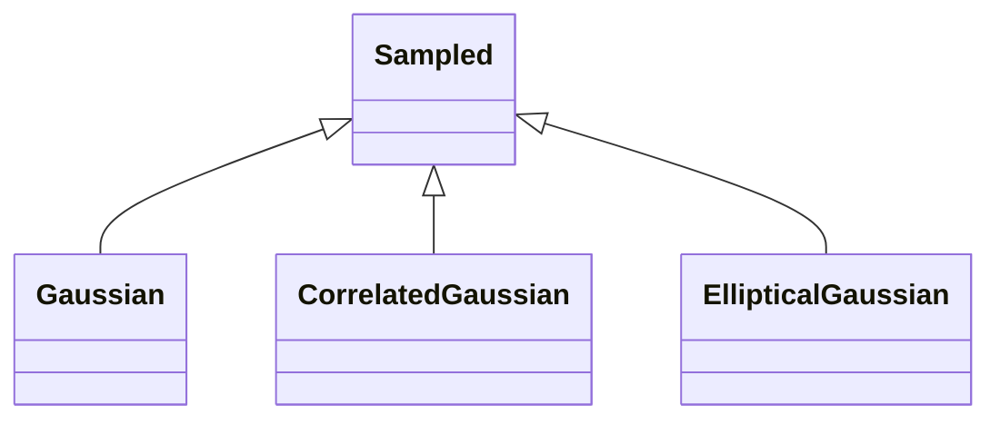

<!-- Generated by docs/scripts/generate_api_mds.py; do not edit. -->

# Numerical / Gaussians

## Inheritance

???+ info "eval_gaussian"
    ::: dLux.utils.numerical.gaussians.eval_gaussian

???+ info "eval_mv_gaussian"
    ::: dLux.utils.numerical.gaussians.eval_mv_gaussian

???+ info "log_gaussian"
    ::: dLux.utils.numerical.gaussians.log_gaussian

???+ info "log_mv_gaussian"
    ::: dLux.utils.numerical.gaussians.log_mv_gaussian

???+ info "correlated_covariance"
    ::: dLux.utils.numerical.gaussians.correlated_covariance

???+ info "elliptical_covariance"
    ::: dLux.utils.numerical.gaussians.elliptical_covariance

???+ info "Gaussian"
    ::: dLux.utils.numerical.gaussians.Gaussian
        options:
          merge_init_into_class: true
          inherited_members: [__init__]

???+ info "CorrelatedGaussian"
    ::: dLux.utils.numerical.gaussians.CorrelatedGaussian
        options:
          merge_init_into_class: true
          inherited_members: [__init__]

???+ info "EllipticalGaussian"
    ::: dLux.utils.numerical.gaussians.EllipticalGaussian
        options:
          merge_init_into_class: true
          inherited_members: [__init__]
