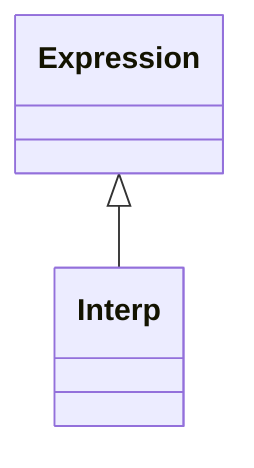

<!-- Generated by docs/scripts/generate_api_mds.py; do not edit. -->

# Numerical / Interpolation

## Inheritance

???+ info "Interp"
    ::: dLux.utils.numerical.interpolation.Interp
        options:
          merge_init_into_class: true
          inherited_members: [__init__]

???+ info "interp"
    ::: dLux.utils.numerical.interpolation.interp
