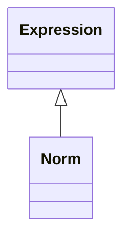

<!-- Generated by docs/scripts/generate_api_mds.py; do not edit. -->

# Numerical / Norms

## Inheritance

???+ info "Norm"
    ::: dLux.utils.numerical.norms.Norm
        options:
          merge_init_into_class: true
          inherited_members: [__init__]

???+ info "norm"
    ::: dLux.utils.numerical.norms.norm

???+ info "normalise"
    ::: dLux.utils.numerical.norms.normalise
