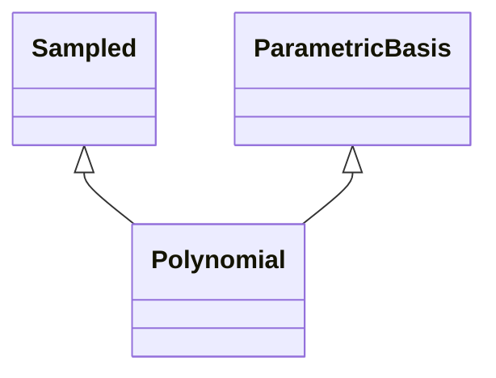

<!-- Generated by docs/scripts/generate_api_mds.py; do not edit. -->

# Numerical / Polynomials

## Inheritance

???+ info "polynomial_powers"
    ::: dLux.utils.numerical.polynomials.polynomial_powers

???+ info "polynomial_basis"
    ::: dLux.utils.numerical.polynomials.polynomial_basis

???+ info "eval_polynomial"
    ::: dLux.utils.numerical.polynomials.eval_polynomial

???+ info "solve_polynomial"
    ::: dLux.utils.numerical.polynomials.solve_polynomial

???+ info "Polynomial"
    ::: dLux.utils.numerical.polynomials.Polynomial
        options:
          merge_init_into_class: true
          inherited_members: [__init__]
