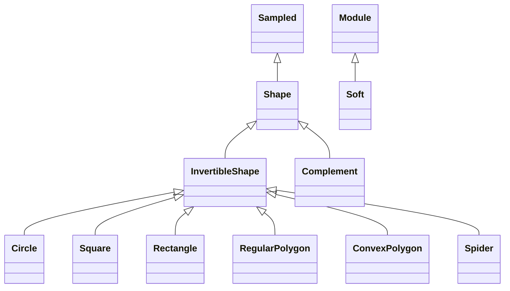

<!-- Generated by docs/scripts/generate_api_mds.py; do not edit. -->

# Numerical / Shapes

## Inheritance

???+ info "shift_and_scale"
    ::: dLux.utils.numerical.shapes.shift_and_scale

???+ info "soften"
    ::: dLux.utils.numerical.shapes.soften

???+ info "circ_distance"
    ::: dLux.utils.numerical.shapes.circ_distance

???+ info "square_distance"
    ::: dLux.utils.numerical.shapes.square_distance

???+ info "rectangle_distance"
    ::: dLux.utils.numerical.shapes.rectangle_distance

???+ info "spider_distance"
    ::: dLux.utils.numerical.shapes.spider_distance

???+ info "line_distance"
    ::: dLux.utils.numerical.shapes.line_distance

???+ info "reg_polygon_edges"
    ::: dLux.utils.numerical.shapes.reg_polygon_edges

???+ info "reg_polygon_distance"
    ::: dLux.utils.numerical.shapes.reg_polygon_distance

???+ info "convex_polygon_distance"
    ::: dLux.utils.numerical.shapes.convex_polygon_distance

???+ info "validate_convex"
    ::: dLux.utils.numerical.shapes.validate_convex

???+ info "Shape"
    ::: dLux.utils.numerical.shapes.Shape
        options:
          merge_init_into_class: true
          inherited_members: [__init__]

???+ info "InvertibleShape"
    ::: dLux.utils.numerical.shapes.InvertibleShape
        options:
          merge_init_into_class: true
          inherited_members: [__init__]

???+ info "Soft"
    ::: dLux.utils.numerical.shapes.Soft
        options:
          merge_init_into_class: true
          inherited_members: [__init__]

???+ info "Circle"
    ::: dLux.utils.numerical.shapes.Circle
        options:
          merge_init_into_class: true
          inherited_members: [__init__]

???+ info "Square"
    ::: dLux.utils.numerical.shapes.Square
        options:
          merge_init_into_class: true
          inherited_members: [__init__]

???+ info "Rectangle"
    ::: dLux.utils.numerical.shapes.Rectangle
        options:
          merge_init_into_class: true
          inherited_members: [__init__]

???+ info "RegularPolygon"
    ::: dLux.utils.numerical.shapes.RegularPolygon
        options:
          merge_init_into_class: true
          inherited_members: [__init__]

???+ info "ConvexPolygon"
    ::: dLux.utils.numerical.shapes.ConvexPolygon
        options:
          merge_init_into_class: true
          inherited_members: [__init__]

???+ info "Spider"
    ::: dLux.utils.numerical.shapes.Spider
        options:
          merge_init_into_class: true
          inherited_members: [__init__]

???+ info "Complement"
    ::: dLux.utils.numerical.shapes.Complement
        options:
          merge_init_into_class: true
          inherited_members: [__init__]
