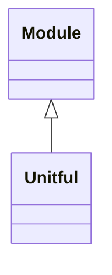

<!-- Generated by docs/scripts/generate_api_mds.py; do not edit. -->

# Numerical / Units

## Inheritance

???+ info "Unitful"
    ::: dLux.utils.numerical.units.Unitful
        options:
          merge_init_into_class: true
          inherited_members: [__init__]

???+ info "canonical_unit"
    ::: dLux.utils.numerical.units.canonical_unit

???+ info "unit_dimension"
    ::: dLux.utils.numerical.units.unit_dimension

???+ info "unit_factor"
    ::: dLux.utils.numerical.units.unit_factor

???+ info "unit_factor_to_rad"
    ::: dLux.utils.numerical.units.unit_factor_to_rad

???+ info "convert"
    ::: dLux.utils.numerical.units.convert
