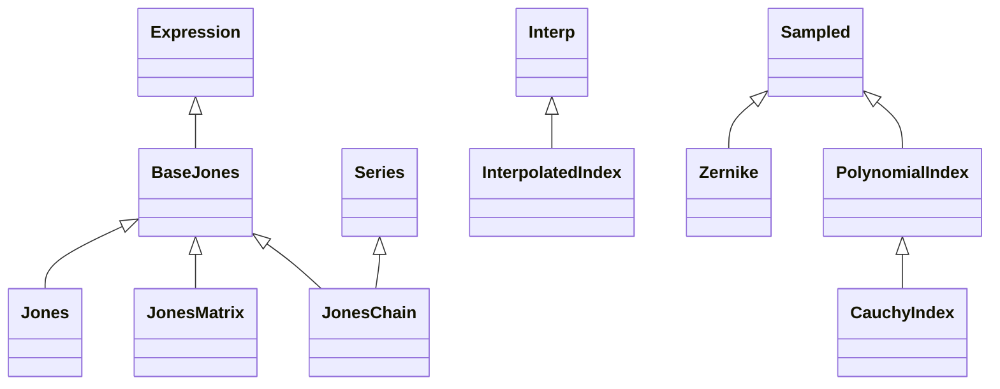

<!-- Generated by docs/scripts/generate_api_mds.py; do not edit. -->

# Optical

See the [usage overview](../../overviews/utils/optical/overview.md) for examples.

## Inheritance

???+ info "wavenumber"
    ::: dLux.utils.optical.phase.wavenumber

???+ info "opd2phase"
    ::: dLux.utils.optical.phase.opd2phase

???+ info "phase2opd"
    ::: dLux.utils.optical.phase.phase2opd

???+ info "fringe_size"
    ::: dLux.utils.optical.phase.fringe_size

???+ info "tilt_opd"
    ::: dLux.utils.optical.phase.tilt_opd

???+ info "tilt"
    ::: dLux.utils.optical.phase.tilt

???+ info "BaseJones"
    ::: dLux.utils.optical.jones.BaseJones
        options:
          merge_init_into_class: true
          inherited_members: [__init__]

???+ info "Jones"
    ::: dLux.utils.optical.jones.Jones
        options:
          merge_init_into_class: true
          inherited_members: [__init__]

???+ info "JonesMatrix"
    ::: dLux.utils.optical.jones.JonesMatrix
        options:
          merge_init_into_class: true
          inherited_members: [__init__]

???+ info "JonesChain"
    ::: dLux.utils.optical.jones.JonesChain
        options:
          merge_init_into_class: true
          inherited_members: [__init__]

???+ info "CauchyIndex"
    ::: dLux.utils.optical.refractive.CauchyIndex
        options:
          merge_init_into_class: true
          inherited_members: [__init__]

???+ info "PolynomialIndex"
    ::: dLux.utils.optical.refractive.PolynomialIndex
        options:
          merge_init_into_class: true
          inherited_members: [__init__]

???+ info "InterpolatedIndex"
    ::: dLux.utils.optical.refractive.InterpolatedIndex
        options:
          merge_init_into_class: true
          inherited_members: [__init__]

???+ info "Zernike"
    ::: dLux.utils.optical.zernikes.Zernike
        options:
          merge_init_into_class: true
          inherited_members: [__init__]
